# NosTale Packet Logger

A packet logger and automation engine for **NosTale**. A small DLL inside the
game reads the packets the client has already decrypted and can send packets
back through the game's own send function; a host outside the game shows them,
logs them and turns them into a live world model you can act on.

| Tree | What it is |
|---|---|
| [`linux/`](linux/README.md) | **Native Linux port**: the in-game DLL is still 32-bit Windows code (cross-built with MinGW); everything around it is native — TCP loopback, Python host/CLI, GTK4 GUI. |
| [`windows/`](windows/README.md) | **Original Windows implementation**, unchanged: MSVC DLL, C++ injector, C# WinForms GUI, named pipes. |

The packet documentation in [`docs/protocol/`](docs/protocol/README.md) is
shared: the transport differs, the game's packets do not.

## The app

The Linux GUI has eight tabs. Each one has a `?` next to its title with the
same explanation the section needs; the pictures below are generated from the
real window against a fake client with real map/item data
(`linux/scripts/readme-shots.sh`), so no account is shown.

### Packets


Every decrypted packet with time, direction, opcode and raw text, newest
first. The filter matches opcode or text; **Send** writes a raw packet through
the DLL (the same path the bot uses); **Follow** keeps the newest row in view;
**Clear** empties only the view — the session log stays on disk.

### Map / Bot


The client's own `NStcData` grids, drawn with the character, monsters, NPCs,
players, drops, portals (`gp`) and Time-Space entrances (`wp`). Click
waypoints and the tab builds an **8-direction A\*** route (no corner cutting);
**Start/Stop** walk it, **Loop** repeats it, **Block portals** keeps a farming
loop off warp tiles. **Follow player** and **Mirror movement & spells** drive a
second client from this one. **Auto-attack** and **Retaliate** pick fights
(target filter by vnum, optional unknown-vnum monsters), **Pickup** collects
drops on the way, and **Auto-recover HP/MP** sits down below the configured
percentages; the whole configuration saves and loads as JSON.

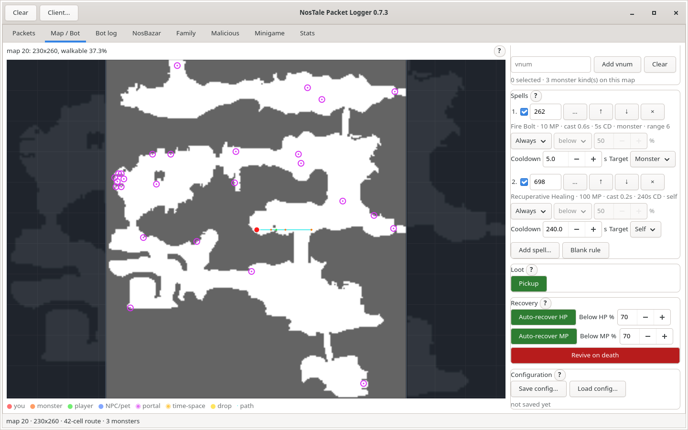

Spell rules cast by HP/MP condition with their own cooldown and target,
ordered top to bottom; skill data (MP, cast time, range) is read from the
client's own `Skill.dat`.

### Bot log

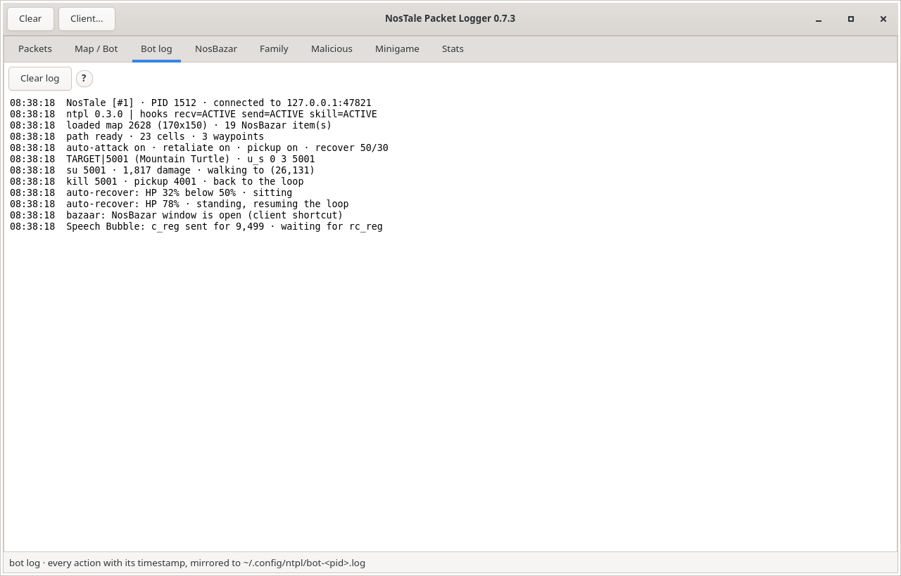

Every action — target selections and refusals, attacks, walks, pickups,
recovery, bazaar steps, DLL errors — with a timestamp. The same lines are
mirrored to `~/.config/ntpl/bot-<winpid>.log` so they can be tailed outside
the GUI.

### NosBazar

The auction-house workflow of
[`TaraJura/Nostale-NB`](https://github.com/TaraJura/Nostale-NB), with a
**second-level navbar**: **Inventory**, **Relist**, **Monitor**, **Items**,
**Configuration**. **Monitor** itself splits into **NosMall** (gold per ND)
and **NPC resale** (gold markup over the NPC price).

#### Inventory

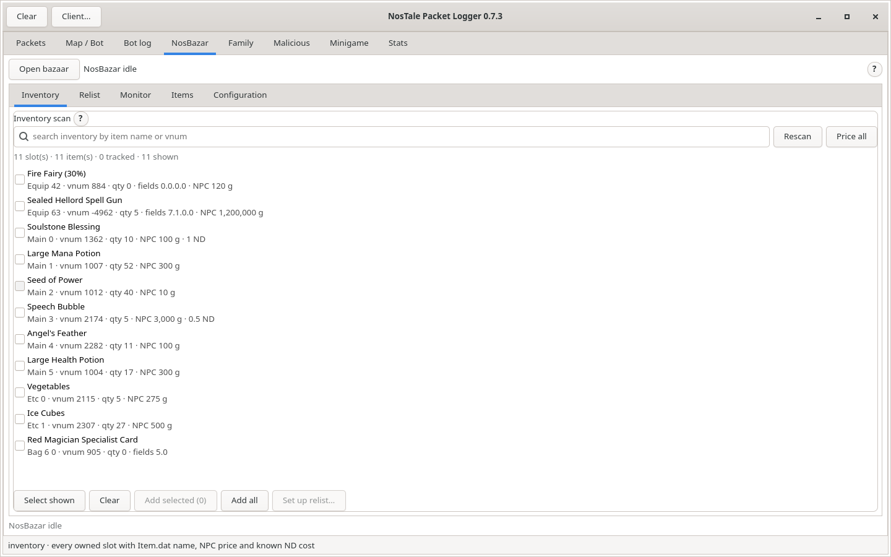

Every slot the client reports (Main/Etc, Equip, bags 6/7) with the Item.dat
name, bag/slot, vnum, quantity, NPC price and known ND cost. Search by name or
vnum; **Rescan**, **Add selected**, **Add all**, **Price all**, and **Set up
relist…** for one item.

#### Relist


The relist set. Tick a row to add it, untick to keep watching without
changing its listing; **Add from Items** / **Add from Inventory** / **Remove
from relisting**, **Only relisting**, Ctrl+click and **Group actions…**. Set
the exact **Item vnum / Tab / Amount** and a positive **Min price**; the badge
reads `ready` / `needs floor` / `needs vnum/tab`. With **Allow live
re-listing** and your **Character** name, **Relist Start** opens the bazaar
itself (Bibi Basar, the portable NosBazar medal, or the client's own
shortcut), undercuts the cheapest other listing by one gold — never below the
floor — and charges the bazaar's 50-gold minimum listing fee. The status
reads `register accepted (rc_reg)` or `register ignored (no rc_reg)`.

#### Monitor

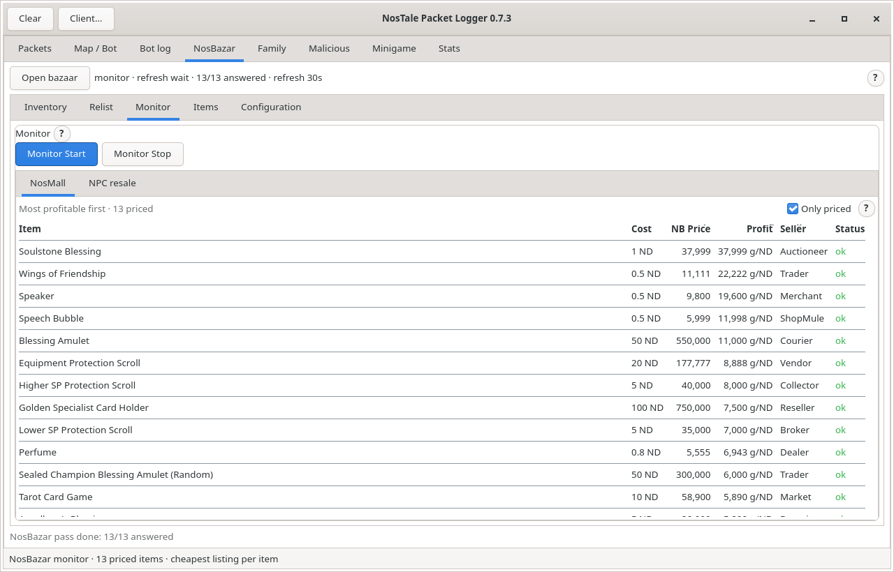

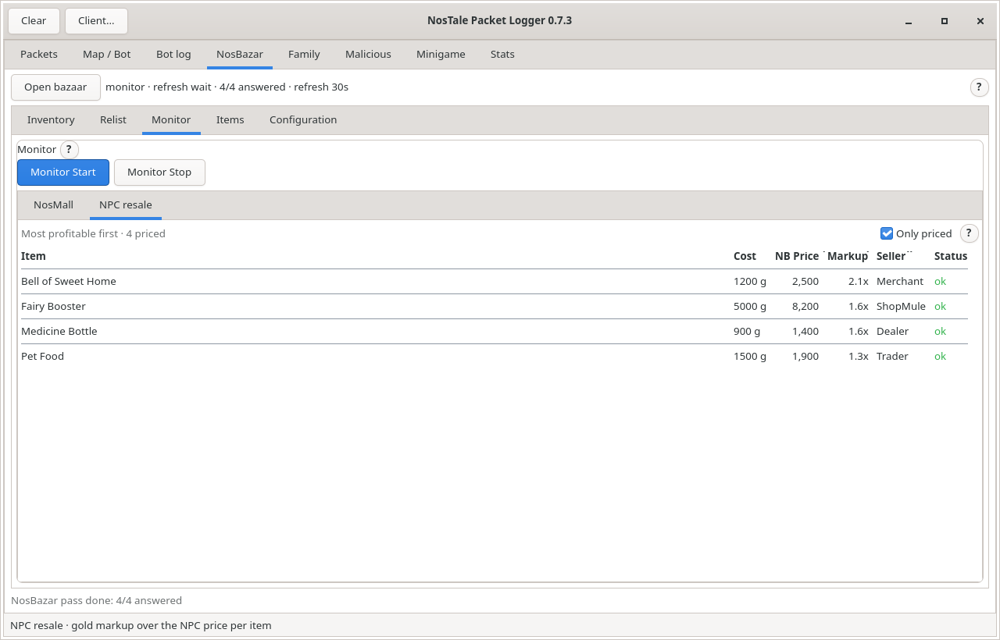

One search pass at the required 2.5 s pacing over every enabled item, cheapest
listing per item, sorted most profitable first; **Only priced** hides empty
rows and timed-out items get one retry. The **NosMall** view shows gold per
ND; **NPC resale** shows the gold markup over the NPC price for items bought
at an NPC (Pet Food, Bell of Sweet Home, …).

#### Items

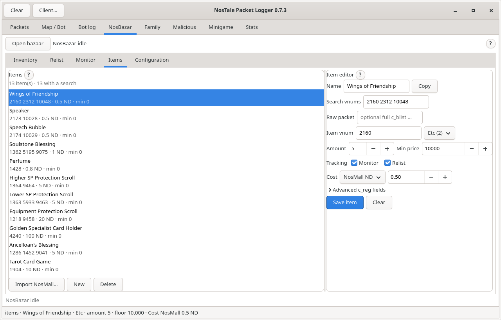

The full editor for one item: Name, Search vnums, raw `c_blist`, Item vnum,
Tab, Amount, Min price, the cost type (which chooses the Monitor view) and the
advanced `c_reg` constants. **Import NosMall…**, **New** and **Delete** manage
the catalog.

#### Configuration

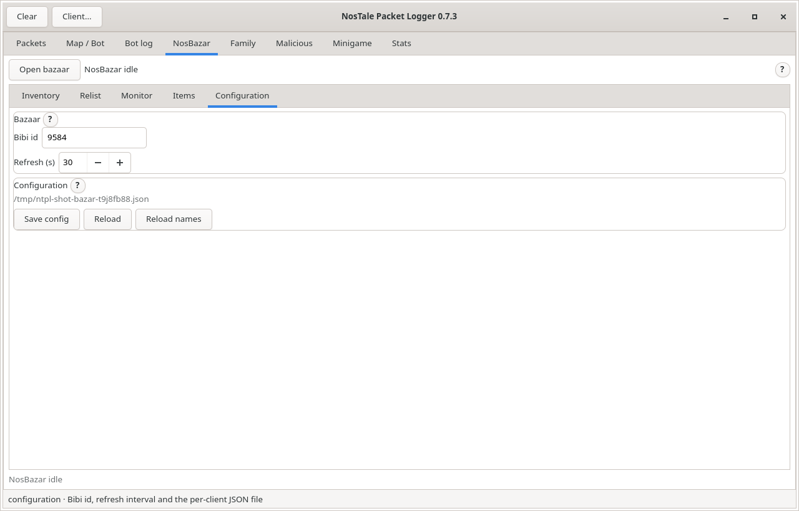

The Bibi entity id, the refresh interval and the per-client JSON file, with
**Save config**, **Reload** and **Reload names** (re-read item names after a
database rebuild).

Each game window keeps its own configuration at
`~/.config/ntpl/bazar-<winpid>.json`; prices, packet formats and the relist
state machine are documented in [docs/bazar.md](docs/bazar.md) and
[docs/protocol/bazaar.md](docs/protocol/bazaar.md).

### Family

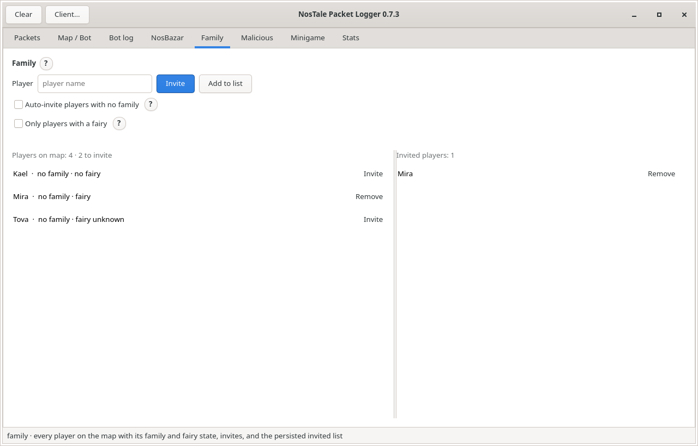

Invites through the client's own `%Familyinvite <name>` command and mirrors
the same command when it is typed in game. **Auto-invite players with no
family** walks the map's candidates nearest first, waits out the server's
15 s cooldown with a countdown, and keeps a persisted invited list so a
decline is never retried; **Only players with a fairy** filters out fresh alt
accounts. See [docs/family.md](docs/family.md).

### Malicious

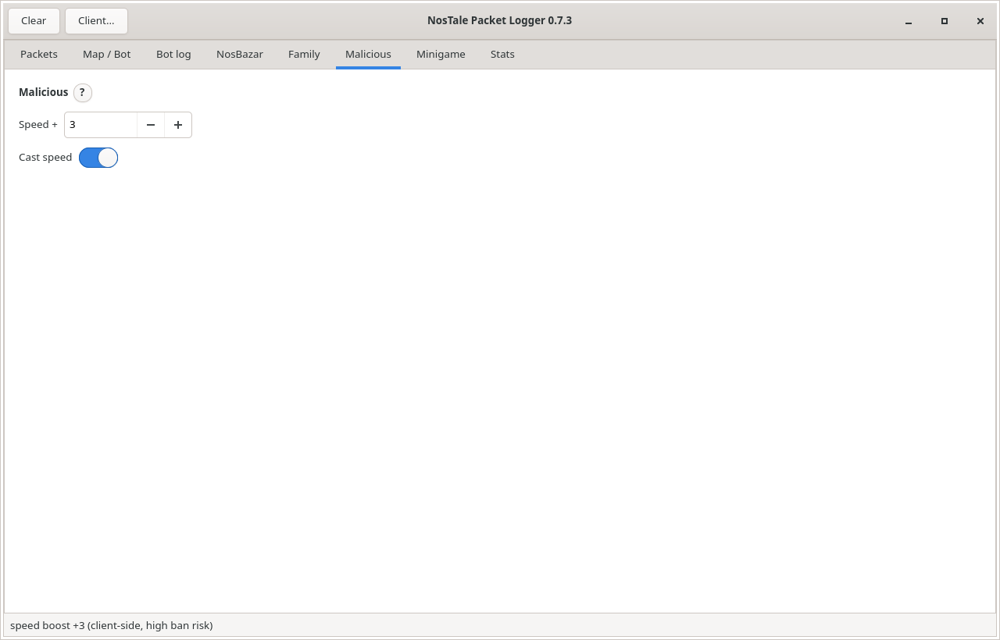

Client-side tweaks that work without the bot. **Speed +** adds flat points of
walking speed through the client's own entity setter while every outgoing
`walk` keeps the server's normal speed (the slip is client-side; the DLL
raises the client's own 59 cap and emulates past the byte's 255). **Cast
speed** repeats the last skill every time the server says its cooldown ended,
and with the bot running the next spell goes out immediately, overlapping the
current cast; the server's cast time and cooldown remain the floor. Both are
game-rule violations — high ban risk, the account owner's decision.

### Minigame

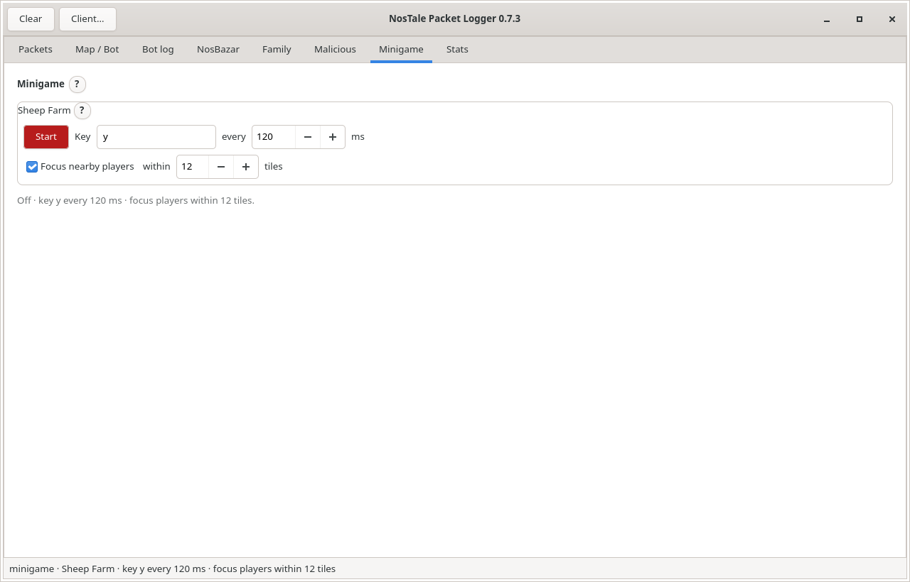

Sheep Farm helper: **Start** spams a key press through the DLL at the chosen
interval (default `y`, the secondary attack; `z` on QWERTZ), and **Focus
nearby players** keeps the nearest other player selected through the client's
own selector — never an NPC, pet, monster or the local character, so the
spammed attack lands on a player instead of a sheep. Settings are saved per
client in `~/.config/ntpl/minigame-<winpid>.json`. Needs DLL 0.3.0. See
[docs/minigame.md](docs/minigame.md).

### Stats

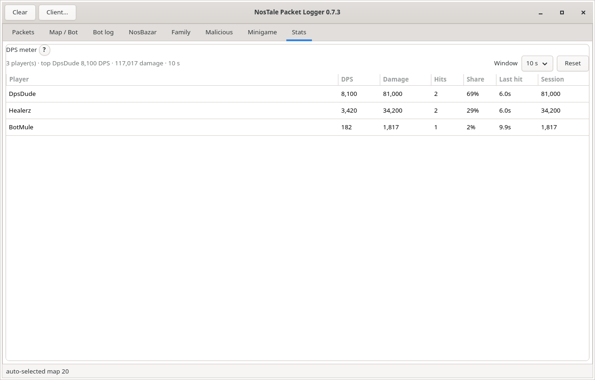

A player **DPS meter** fed by the decoded `su` damage: name, DPS, damage,
hits, share, last hit and session total, over a 5/10/30/60 s window or the
whole session, sorted by DPS. Partner/monster hits and zero-damage buffs are
ignored; **Reset** clears the totals. It refreshes twice a second while the
tab is visible and keeps collecting in the background. See
[docs/stats.md](docs/stats.md).

### Client picker

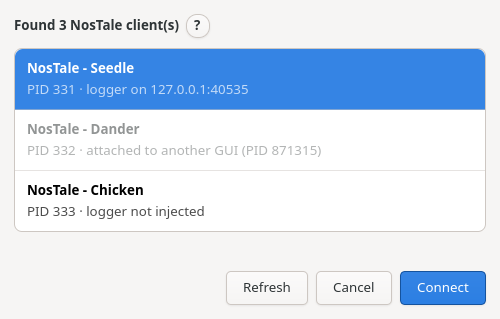

The picker gives each running game client its own window. A client already
attached by another window is disabled, an uninjected client can be injected
from here, and the title shows the host version plus the attached client's
DLL version.

## Quick start

```bash
sudo apt install g++-mingw-w64-i686 xvfb          # once
make -C linux all test-host                       # DLL + injector + 357 unit tests
make -C linux gui-test bot-test                   # 6 GTK4 smokes, 43 fake-server smokes

linux/scripts/inject.sh        # optional: the GUI picker can inject too
linux/scripts/gui.sh           # one window per client; run again for another

# agent access (MCP over stdio; owns the DLL link, the GUI joins on 47900)
PYTHONPATH=linux/host python3 -m ntpl mcp
linux/scripts/gui.sh --port 47900
```

The native `speed-test` and `key-test` check the DLL-side parsers;
`linux/scripts/dev-test-wine.sh 25` exercises the hook stubs and DLL lifecycle
without a game. On Windows, build `windows\PacketLogger.sln` (x86 Release),
run `Injector.exe` as administrator and open `PacketLoggerGUI`.

## Documentation

Start with [docs/architecture.md](docs/architecture.md), then:

- [docs/engine.md](docs/engine.md) — host API, world model, CLI, MCP
- [docs/map.md](docs/map.md) — maps, A\*, Map/Bot tab, path loop
- [docs/bot-config.md](docs/bot-config.md) — target filters, spell rules
- [docs/bazar.md](docs/bazar.md) — the NosBazar tab end to end
- [docs/family.md](docs/family.md) · [docs/minigame.md](docs/minigame.md) ·
  [docs/stats.md](docs/stats.md) — the other tabs
- [docs/database.md](docs/database.md) — the SQLite game/packet database and
  the NosMall catalog
- [docs/autonomous-play.md](docs/autonomous-play.md) — observe → decide → act
  → confirm → survive, GUI↔MCP handover
- [docs/hooking.md](docs/hooking.md) — detours, patterns, assembly stubs
- [docs/ipc.md](docs/ipc.md) — the TCP message protocol
- [docs/troubleshooting.md](docs/troubleshooting.md) — symptom → cause → fix
- [docs/linux.md](docs/linux.md) · [docs/windows.md](docs/windows.md) —
  per-tree setup
- [docs/development.md](docs/development.md) — layout, conventions, tests

## Status

Host **0.7.3** (Linux): 357 unit tests, 6 GTK4 window smokes and 43
fake-server bot smokes pass, and the real injector has been run against the
live NosTale client under Wine 11 — both hooks `ACTIVE`, movement through the
client's own MoveTo, auto-attack confirmed by the server's `su`, and the
bazaar open/relist/registration verified live (2026-11-23); the DPS meter
decodes the same live `su` damage. The original Windows tree is unchanged.

Gameforge's terms of service prohibit automation and client manipulation.
This is a tool for the account owner's own client; using it on a live account
is their decision and risk. No detection-evasion features.
