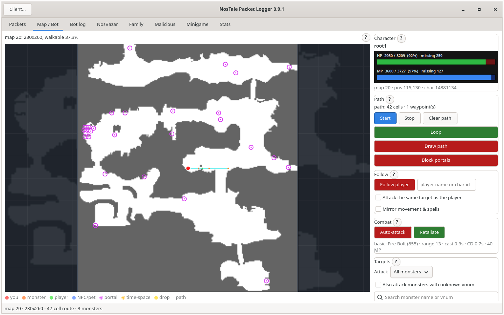
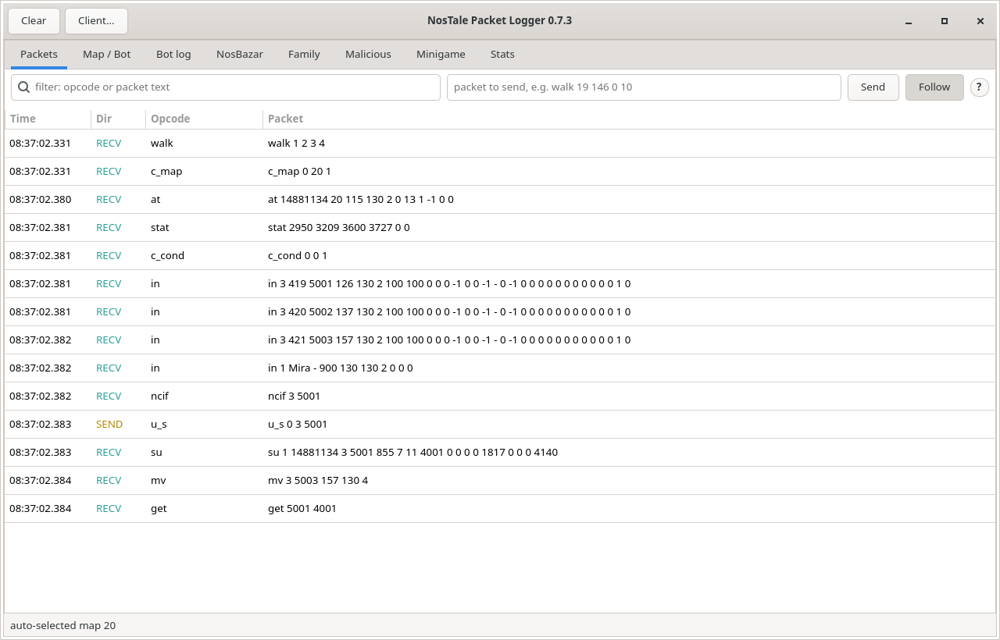

# NosTale Packet Logger

A packet logger and automation engine for the MMORPG **NosTale**. A small DLL
inside the game reads the packets the client has already decrypted, and can
send packets back through the game's own send function. A host outside the game
displays them, logs them, and turns them into a world model.

Two implementations live here:

| Tree | What it is |
|---|---|
| [`linux/`](linux/README.md) | **Native Linux port.** The in-game DLL is still 32-bit Windows code (cross-built with MinGW) because NosTale is; everything around it is native: TCP loopback, Python client/CLI, GTK4 GUI, state engine. |
| [`windows/`](windows/README.md) | **Original Windows implementation**, unchanged. MSVC DLL, C++ injector, C# WinForms GUI, named pipes. |

The packet documentation in [`docs/protocol/`](docs/protocol/README.md) is
shared: the transport differs, the game's packets do not.

## Screenshots



| Live packet stream | One window per game client |
| :---: | :---: |
|  |  |

The **Map / Bot** tab draws the A\* route, monsters, portals and the bot
controls. The picker gives each running game client its own window; a client
already attached by another window is disabled. Each row shows the client's
DLL version read from its log, and the window title shows the host version
plus the attached client's DLL version.

## NosBazar


The fourth tab turns the live packet stream into the player-auction-house
workflow of [`TaraJura/Nostale-NB`](https://github.com/TaraJura/Nostale-NB),
with a **second-level navbar**: **Inventory**, **Relist**, **Monitor**,
**Items** and **Configuration**. **Monitor** has its own **third-level
navbar**: **NosMall** (ND-cost items, gold per ND) and **NPC resale**
(NPC-gold items such as Pet Food or Bell of Sweet Home, gold markup).

- **Inventory** — lists every slot the client reports (Main/Etc, Equip, and
  the extra equipment bags 6/7) with the item name (local DB first, then
  Item.dat), bag/slot, vnum, quantity, equipment fields, NPC price and known
  ND cost. Search by name or vnum; **Set up relist…** adds one checked item
  with its exact vnum/tab/amount
  and opens Relist; **Add selected** adds checked items; **Add all** adds
  every distinct item; **Price all** also starts Monitor.
  Equipment quantity 0 counts as one; bound negative vnums are searched by
  their absolute template but cannot be relisted. If the server's login dump
  was missed, the list is empty or marked **partial** — relog once with the
  window open and it fills automatically; the last complete inventory is
  cached per character, so later attaches survive another log truncation.
- **Relist** — the list is the relist set. Tick a row to include the item;
  untick it to stop changing that listing while Monitor keeps watching it
  (the item, its floor and its monitor state stay). **Add from Items** takes
  the current Items selection, **Add from Inventory** takes the rows ticked
  in Inventory and fills vnum/tab/amount from the slot, **Remove from
  relisting** clears the selected row, and **Only relisting** hides the
  rest. Ctrl+click selects several rows; **Group actions…** offers **Select
  all shown**, **Unselect all**, **Relist all shown**, **Stop relisting all
  shown**, **Relist selected** and **Stop relisting selected**. A single tick
  updates its row in place and renders keep the scroll position, so a long
  list no longer jumps to the top; clicking the only selected row again
  unselects it. Select an item, set its **Item vnum**, **Tab**, **Amount** and a
  positive **Min price**; the badge reads **ready** / **needs floor** /
  **needs vnum/tab** / **not relisting**. Fill
  **Character** with your own name, tick **Allow live re-listing**, then
  **Relist Start**. Each pass searches only the relist set and undercuts the
  cheapest other listing by one gold, never below the floor; the status
  reports **register accepted (rc_reg)** when the server answers, or
  **register ignored (no rc_reg)** when it silently drops the packet (the
  bazaar window must be open — `wopen 32`, a search answer alone is not
  proof — and `unk1` is repaired from Item.dat before each pass; `unk2` is
  item-specific).
  The **Items** editor carries the same two tracking switches, **Monitor**
  and **Relist**.
- **Monitor** — starts/stops searches, opens the Bibi Basar dialog through
  the client's own send path, learns the map/session NPC id and dialog option
  from your own opening (or the DLL log), and searches at the required 2.5 s
  pacing. A learned id that this map's entity list knows as another NPC is
  refused (ids are per map instance; it once opened Carve Runes), so walk
  next to a Bibi on the current map before starting. With no Bibi visible the
  controller uses the portable **NosBazar medal** (vnum 1955) from the
  Main/Etc bag (`u_i`) and waits for the bazaar window. One **Monitor Start**
  searches both third-level views; each has its
  own **Only priced** filter and row count. The **NosMall** view shows ND
  items with the profit in gold per ND; **NPC resale** shows items bought at
  an NPC, e.g. Pet Food or Bell of Sweet Home, with the **Markup** column
  (listing ÷ NPC price). Timed-out items get one retry; the next refresh
  follows the configured interval. Results show the cheapest listing, seller,
  price and status, sorted **most profitable first**; thin rules keep each row
  aligned. The **Item** column is the real item name for the row's vnum
  (local DB first, then Item.dat) whenever it resolves, not the configured
  shortcut; hover the item name for the shortcut and search vnums.
- **Items** — the full editor for one item: **Name** (the shortcut label),
  **Search vnums**, **Raw packet**, **Item vnum**, **Tab**, **Amount**,
  **Min price**, **Cost** and the advanced `c_reg` fields. The **Cost** type
  chooses the Monitor view: NosMall ND → NosMall, NPC gold → NPC resale (its
  Item.dat price auto-fills when left at 0), No cost → NosMall as price
  discovery. **Import NosMall…** adds catalog groups with a known ND cost
  (pets/fairies/partner supplies excluded), **New** and **Delete** edit the
  list.
- **Configuration** — **Bibi id**, **Refresh (s)**, the per-client JSON path,
  **Save config**, **Reload**, and **Reload names** (re-read item names after
  rebuilding the database).
- **Copy names** — right-click a result's item name or an item row to copy
  the real name; **Copy** next to **Name** copies the configured label.
- **Per client** — each game window keeps its own configuration at
  `~/.config/ntpl/bazar-<winpid>.json`; selections are saved when the item
  list changes and on shutdown.

The packet formats and state machine are documented in
[docs/bazar.md](docs/bazar.md) and [docs/protocol/bazaar.md](docs/protocol/bazaar.md);
the catalog/database side is in [docs/database.md](docs/database.md).

## Minigame

The seventh tab automates the **Sheep Farm** mini-raid (five minutes,
free-for-all, NPC sheep worth 5 points, a disguised player 20). **Start** spams
a key press at the game window every interval — default `y`, the
secondary-weapon attack on layouts that bind it to Y (`z` on QWERTZ) — and
**Focus nearby players** keeps the nearest *player* selected through the
client's own selector. Pets, NPCs, monsters (including the sheep) and the local
character are never chosen, so the spammed attack lands on a player rather than
a sheep. The key and focus work with or without the bot (use the bot off in the
raid: both select a target); each `KEY|` press is queued to a DLL thread (real
`SendInput` when the game is focused, a posted key otherwise) and never delays
packets. Settings are saved per client in
`~/.config/ntpl/minigame-<winpid>.json`.

`KEY|` needs **DLL 0.3.0**: updating the build is not enough, the running
client keeps the old module. Restart the game, inject again, and check the
title shows `DLL 0.3.0`. An old DLL is detected and the tab stops with a clear
message. Details, edge cases and troubleshooting: [docs/minigame.md](docs/minigame.md).

## Autonomous play

The MCP server can drive a character through observe → decide → act →
confirm → survive: it seeds the map's entities from the attached client's
log, resyncs a client that desynced during a warp with the `walk -1 -1` →
`tp` probe, and confirms every hit and kill with the server's `su` packets.
The policy — target risk, approach/kite geometry, HP thresholds, retreat and
recovery, the GUI↔MCP single-host handover and the known failure modes — is
in [docs/autonomous-play.md](docs/autonomous-play.md). Live 2026-11-22: an
SP card was equipped, a Mt. Krem wolf was killed and the character survived
two more wolves that joined the fight.

## Quick start on Linux

```bash
sudo apt install g++-mingw-w64-i686          # once
make -C linux all test-host                  # DLL + injector + test fixtures
make -C linux host-test                      # 351 Python unit tests
make -C linux speed-test                     # DLL speed-boost parsing and walk clamp
make -C linux key-test                       # DLL KEY| name parsing
make -C linux gui-test                       # six headless GTK4 smokes (xvfb)
make -C linux bot-test                       # 43 fake-server bot smokes

# no game required: x86 hook stubs + DLL lifecycle + TCP + command path
linux/scripts/dev-test-wine.sh 25

# with the game running in its own prefix:
linux/scripts/inject.sh        # optional: the GUI can inject from its picker
linux/scripts/host.sh status
linux/scripts/host.sh monitor
linux/scripts/gui.sh           # one window per client; run again for another

# agent access (MCP over stdio; owns the DLL link, GUI joins on 47900)
PYTHONPATH=linux/host python3 -m ntpl mcp
linux/scripts/gui.sh --port 47900
```

## Quick start on Windows

```powershell
msbuild windows\PacketLogger.sln /p:Configuration=Release /p:Platform=x86
```

Run `Injector.exe` as administrator, then open `PacketLoggerGUI`.

## Documentation

Start with [docs/architecture.md](docs/architecture.md), then:

- [docs/engine.md](docs/engine.md) — the Python host API, state model, CLI
  commands and action confirmations
- [docs/map.md](docs/map.md) — `NStcData` maps, walkability, 8-direction A*,
  the Map/Bot tab, path loop, auto-attack and tooltips
- [docs/bot-config.md](docs/bot-config.md) — monster target filters,
  conditional spell rules and JSON export/import
- [docs/family.md](docs/family.md) — the **Family** tab: `%Familyinvite`
  packet, server confirmation and live test accounts
- [docs/bazar.md](docs/bazar.md) — the **NosBazar** tab: inventory scan,
  two-view (NosMall / NPC resale) cheapest-listing monitor with gold/ND and
  NPC-gold markup, plus floor-protected relisting (ported from
  `TaraJura/Nostale-NB`); packet formats in
  [docs/protocol/bazaar.md](docs/protocol/bazaar.md) and
  [docs/protocol/inventory.md](docs/protocol/inventory.md)
- [docs/minigame.md](docs/minigame.md) — the **Minigame** tab: Sheep Farm key
  spam, player-only focus and the DLL `KEY|` command
- [docs/stats.md](docs/stats.md) — the **Stats** tab: a player DPS meter fed
  by the decoded `su` damage, with 5/10/30/60 s or session windows
- [docs/database.md](docs/database.md) — local SQLite **game + packet
  database** built from the client archives and public NosTale projects;
  includes the full NosMall catalog and an import picker in the tab
- [docs/mcp.md](docs/mcp.md) — MCP server for agents: state, movement,
  combat, raw packets, and the local broker that lets the GUI watch too
- [docs/autonomous-play.md](docs/autonomous-play.md) — the observe → decide →
  act → survive playbook: `game_resync` after a warp, log entity seeding,
  target risk and HP thresholds, retreat/recovery, GUI↔MCP handover and the
  2026-11-22 live kill-and-survive session
- [docs/handoff-2026-11-06.md](docs/handoff-2026-11-06.md) — current state and
  the exact post-reboot reinjection + auto-attack test procedure
- [docs/live-session-2026-11-06.md](docs/live-session-2026-11-06.md) — what was
  verified on the running client, the bugs fixed and the open items
- [docs/feature-review-2026-11-06.md](docs/feature-review-2026-11-06.md) —
  feature inventory, test coverage and live combination results
- [docs/hooking.md](docs/hooking.md) — how the detours, patterns and assembly
  stubs work, and how to repair them after a client patch
- [docs/ipc.md](docs/ipc.md) — the TCP message protocol
- [docs/linux.md](docs/linux.md) — Wine, MinGW, host, GUI, tests
- [docs/windows.md](docs/windows.md) — the original MSVC/C# tree
- [docs/development.md](docs/development.md) — layout, conventions, adding packets
- [docs/roadmap.md](docs/roadmap.md) — phases and next tasks
- [docs/troubleshooting.md](docs/troubleshooting.md) — symptom → cause → fix
- [docs/reusable-projects.md](docs/reusable-projects.md) — MIT-licensed upstream
  Gameforge/NosTale projects we can reuse (clientless login, launcher
  emulation, protocol crypto, widget layouts)

## Status

The Linux port builds, its 351 unit tests pass, the six GTK4 window smokes
and 41 bot smoke tests pass, and the real injector has been run against
the **live NosTale client** under Wine 11:

- both hooks `ACTIVE` (`recv=0x004DBB4D send=0x004EB5C4 tnt=0x0055AA84`),
  `drops recv=0`;
- `rest 1 1 14881134` stood the character up; the server answered
  `rest 1 14881134 0`;
- movement calls the client's own MoveTo through the DLL's `MOVE|x y`; the
  client pathfinds, animates and sends its own `walk` packet. `POS` reads its
  local position, char id and sit flag (so a host attaching while sitting
  stands up before walking). Injecting a raw `walk` (checksum `1 if (x+y)%3 == 1`) moves
  only the server, and the correction teleports the client;
- the live GUI bot walked `(26,133)→(23,130)` as six client `[SEND] walk`
  packets, with no injected walks, probes or teleports;
- auto-attack selects the monster in the client (`TARGET|id`, so the client
  highlights it and sends its own `ncif 3 <id>`) and then sends
  `u_s 0 3 <id>`; the server answers with `su ... 866/868 ...`, and
  pickup/ground drops are confirmed with `get`. Live 2026-11-07:
  `TARGET|8684` → client `[SEND] ncif 3 8684` → `su ... 3 8684 855 ...`;
- the skill hook captures the client's own `u_s` packets (`skill=ACTIVE`).

`linux/scripts/host.sh walk X Y` uses `MOVE` and waits for the client's own
`walk` packet. The character must be **standing**: sitting blocks movement and
is controlled by the `rest` packet. Some targets are still ignored (blocked
tile/entity); the bot stops after three rejected steps.

The **NosBazar** tab (fourth page) is described in
[NosBazar](#nosbazar) above: its second-level navbar splits Inventory scan
(with Set up relist…), Relist setup, Monitor results, the full Items editor
and Configuration. Each client keeps its own
`~/.config/ntpl/bazar-<pid>.json`; see [docs/bazar.md](docs/bazar.md).

The **Family** tab (fifth page) invites members with the client's own
`%Familyinvite <name>` command, mirrors the same command when it is typed in
game, and shows the server's `infoi2 234` confirmation. **Auto-invite** scans
map players whose family state is known and empty, invites each name once
(nearest first), waits out the server's 15 s invite cooldown with a visible
countdown, and keeps an editable persisted list so a decline is never retried.
An **Only players with a fairy** filter excludes fresh alt accounts; the map
list labels each candidate fairy / no fairy / fairy unknown.
Live-tested on `redenkor` and `sjkrimer`; see
[docs/family.md](docs/family.md).

The **Minigame** tab (page 7) is described in
[Minigame](#minigame) above: Sheep Farm key spam with a players-only focus,
per-client settings and a DLL `KEY|` command (0.3.0). Live-key verification is
still pending; see [docs/minigame.md](docs/minigame.md).

The **Stats** tab (page 8) is a player **DPS meter**. Every `su` hit from a
player (attacker type 1, positive damage) adds the decoded damage field; the
table lists player name, DPS in the chosen window (5/10/30/60 s or Session),
damage, hits, share, last hit and session total, sorted by DPS. **Reset**
clears the totals; the table refreshes twice a second while the tab is
visible and the meter keeps collecting in the background. Other players
appear when the server broadcasts their hits. See [docs/stats.md](docs/stats.md).

The client's own map grids are parsed from `NostaleData/NStcData.NOS`; live
maps so far include **2, 3, 4, 20, 98, 103** and **104**, and every observed
entity position is on walkable cells.
The GTK4 **Map / Bot** tab renders the map (automatic map switch on `c_map`),
takes click waypoints, computes an **8-direction A\*** path (diagonals, no
corner cutting, continuous polyline), and can loop it while auto-attacking
monsters (Retaliate picks the one hitting you), picking up drops, and sitting
to recover below configurable HP/MP % thresholds (after finishing the current kill);
it walks to drops and picks them up before returning to the path. It shows live HP/MP bars plus a red
recovery banner, green/red active toggles, hover tooltips with monster names
from the client's language archive, server-sent portals (`gp`) and Time-Space
entrances (`wp`, with the nosapki stone icon and the client's own "Required
Level N" wording), and an explicit unknown-vnum option for monsters that
spawned before injection. **Block portals** (off by default) drops the
client's own `preq` portal request in the DLL and keeps paths off the warp
tiles, so a farming loop cannot enter another map even from a tile it is
already standing on. **Speed +** (**Malicious** tab, default 0 = normal) adds a
flat bonus to the character's walking speed, the way a NosTale speed buff
works (+1, +2, +3...). The DLL reads the server's `cond` speed, calls the
client's own entity speed setter on the local player actor (the field its
walk builder reads), and clamps the outgoing `walk` speed back to the
server's `cond` value — the server sees a normal walk while the client moves
faster. Live 2026-11-20: base 11, +3 applied (actor 14), every walk packet
stayed 11, no server correction. Type or scroll the spin as far as you like
(the DLL's emulated bound is 2,000,000,000;
needs DLL 0.2.9): on the first value above the client's own 59 limit the DLL
raises that check and extends the client's speed table, and values past the
byte's 255 are emulated through its top entry. It applies immediately
without the bot. If the server corrects the player, it settles at +1 instead
of dropping to 0, or turns off if even +1 is rejected. **Cast speed** (same tab, a plain on/off switch) works with or without
the bot. Press a skill once and it is repeated every time the server
says its cooldown ended, so the character keeps casting at the
server's fastest rate; press another skill to switch, or turn the
switch off. With the bot running, its spells are sent immediately and
overlap the current cast, and a skill is re-cast on its cooldown-end
packet. The server's own cast time cannot be shortened; same-skill
sends faster than the cooldown are refused.
This is a client hack: the game rules prohibit client manipulation, and bot
vendors themselves label speed hacks high ban risk. A third top-level **Bot log** tab keeps a
timestamped, selectable record of every action (attacks, TARGET selections and
refusals, walks, pickups, recovery, DLL errors) for debugging, and mirrors it
to `~/.config/ntpl/bot-<winpid>.log` once a client is attached (`bot.log`
before that; `NTPL_BOT_LOG` overrides) so it can be tailed
outside the GUI. Out-of-range targets are chased on foot and attacked once
in range, like clicking a monster in game. Targets can be filtered by monster
vnum; ordered spell rules cast by HP/MP conditions; the whole bot configuration
is saved/loaded as JSON. `map` commands inspect/render the grids; `make
bot-test` exercises the loop, rules, spell order, rejection and recovery against a fake
server. See [docs/map.md](docs/map.md) and [docs/bot-config.md](docs/bot-config.md).

Gameforge's terms of service prohibit automation. This is a tool for the
account owner's own client; using it on a live account is their decision and
risk.
