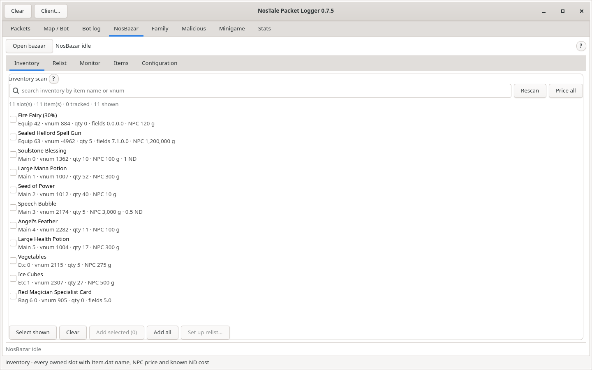
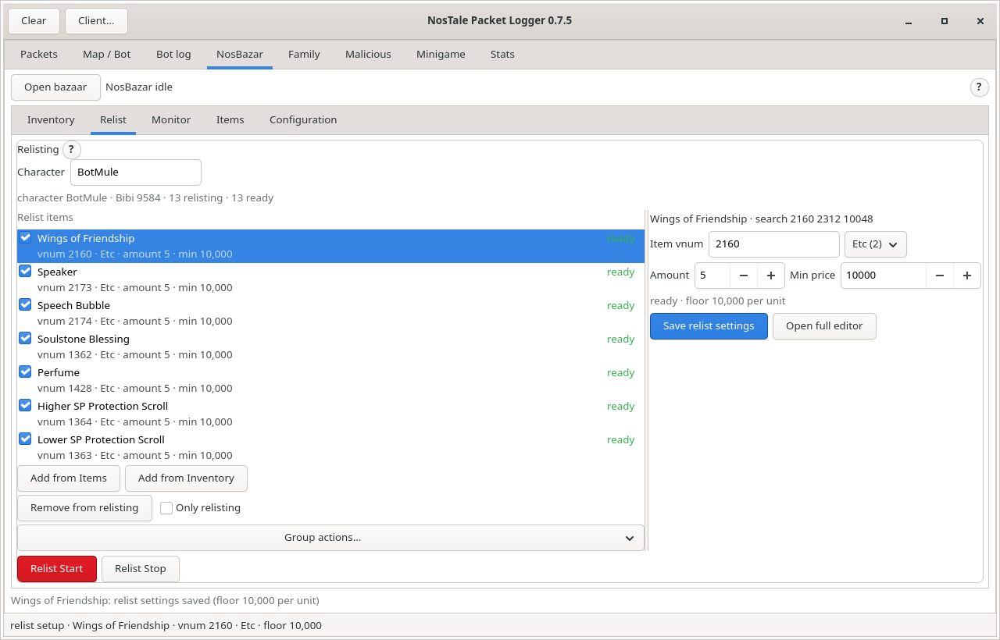

# NosBazar market tab

The **NosBazar** tab ports the two flows of
[`TaraJura/Nostale-NB`](https://github.com/TaraJura/Nostale-NB) into the packet
client:

1. **Monitor** — search each configured item, keep the cheapest listing and
   show its profitability. A third-level navbar splits the results into
   **NosMall** (ND cost; gold per ND) and **NPC resale** (NPC gold cost;
   gold markup), so the cash-shop and NPC-shop opportunities never mix. One
   **Monitor Start** searches both lists.
2. **Relist** — for an item in the inventory, undercut the cheapest other
   seller by one gold and send `c_reg`, never below the configured
   `min_price` floor.
3. **Inventory scan** — list every slot the client reports, with the Item.dat
   name, bag/slot, vnum, quantity, equipment fields, NPC price and known ND
   cost; add items you already own to the monitor, or price the whole
   inventory in one action.

The page is split by a **second-level navbar** into **Inventory**, **Relist**,
**Monitor**, **Items** and **Configuration** sections. **Monitor** itself has
a **third-level navbar** with **NosMall** and **NPC resale** views; the view
is chosen per item by the **Cost** type in the editor, not by a separate
configuration file.

The packet formats and live captures are in
[protocol/bazaar.md](protocol/bazaar.md).

## Quick start

The NosBazar page has a **second-level navbar** so each workflow has its own
full-width section: **Inventory**, **Relist**, **Monitor**, **Items** and
**Configuration**.

1. Attach the GUI to a game client as usual.
2. Walk to a **Bibi Basar** NPC and open the NosBazar **by hand once**. The
   client learns the map-specific NPC entity id and dialog option from your
   own `npc_req`/`n_run` packets (or from this client's DLL log if the GUI
   attached later). The id appears under **Configuration → Bibi id**.
   Entity ids are **per map**: a learned id is only used while this map's
   entity list still shows it as Bibi Basar (vnum 793). If the same id is a
   different NPC — live 2026-11-23: it opened **Carve Runes** — it is
   refused and the controller waits, so changing map needs another manual
   bazaar opening (or walking next to a Bibi so her `in` packet is seen).
   **No Bibi visible?** If the client opens the bazaar with its own
   shortcut — FrosTale answers a bare `c_skill` with `wopen 32` — the
   controller replays exactly that packet first; it learns the pairing from
   the client's own traffic or its DLL log. Otherwise it falls back to the
   portable **NosBazar medal** (Item.dat `Gestore del NosBazar`, vnum
   **1955**) from the Main/Etc bag: it sends
   `u_i 1 <charId> <bag> <slot> 0 0`, waits for `wopen 32`, and starts the
   pass. A visible Bibi wins over the medal; a stale unknown NPC id is only
   tried when no medal is in the inventory, and the medal is never used a
   second time before the refresh interval.
3. Open the **Inventory** section. It lists every slot you own automatically
   from the live `inv`/`ivn` stream (backfilled from the DLL log after a late
   attach): the real item name (local DB first, then Item.dat), bag/slot,
   vnum, quantity, equipment fields, NPC price and known ND cost. Search by
   name or vnum, then:
   - tick **one** row and click **Set up relist…** — it adds the item with the
     exact vnum, tab and stack amount and opens the **Relist** section with
     that item selected;
   - **Add selected** — adds the checked items to the monitor list;
   - **Add all** adds every distinct item; **Price all** adds every item and
     starts Monitor (search only, never relisting).
   If the list is empty or marked **partial**, the login dump was missed:
   relog once with the window open and it fills automatically (then it is
   cached for later attaches).
4. In **Relist**, the list is the relist set. Tick a row to include the item,
   untick it to stop changing that listing while the Monitor keeps watching
   it; **Add from Items** takes the selection in the Items section, **Add
   from Inventory** takes the rows ticked in Inventory (vnum, tab and stack
   amount are filled from the slot), **Remove from relisting** clears the
   selected row and **Only relisting** hides the rest. Set the selected
   item's **Item vnum**, **Tab**, **Amount** and a positive **Min price**
   (the per-unit floor), then **Save relist settings**. Fill **Character**
   with your own name so the host recognises your listing. The list marks
   each item **ready**, **needs floor**, **needs vnum/tab**, **not
   relisting** or **disabled**.
5. Open the **Monitor** section, click **Monitor Start** and watch the
   cheapest listing and profit. The third-level **NosMall** and **NPC
   resale** tabs split the rows by their cost type; each tab has its own
   **Only priced** filter. The **Item** column shows the real item name for
   the row's vnum (see [Item names](#item-names)), not the configured
   shortcut; hover the Item cell for the shortcut and search vnums (every
   result cell carries the raw `rc_blist` fields). Searches use 2.5 s
   pacing; timed-out items get one retry and the next pass starts after
   **Configuration → Refresh (s)** (default 30).
6. Use the **Items** section when you need more than the relist fields: the
   full editor has **Name** (the shortcut label), **Search vnums**,
   **Raw packet**, **Item vnum**, **Tab**, **Amount**, **Min price**,
   **Cost**, the **Tracking** switches (**Monitor**, **Relist**) and the
   advanced `c_reg` fields. The **Cost** type chooses the
   monitor: **NosMall ND** → the NosMall tab, **NPC gold** → the NPC resale
   tab, **No cost** → the NosMall tab as price discovery. For NPC gold, leave
   the **Cost** at 0 on save and the Item.dat NPC price fills in. The list
   shows the real item name too. **Import NosMall…** adds whole catalog
   groups with a ready `c_blist` packet; **New** and **Delete** edit the
   list.
7. To relist, click **Relist Start** in the **Relist** section. **Relist
   Stop** stops it. (Relist Start is the only switch; there is no extra
   "allow live re-listing" checkbox.)

## Monitor views

- **NosMall** — items with a positive `nos_cost`. Profit is the cheapest
  listing in gold per ND spent. Items with no cost at all also appear here,
  so a newly added search can be watched before its cost is known.
- **NPC resale** — items with an NPC gold cost. Profit is the **Markup**
  column: cheapest listing ÷ NPC price. Buy the item at the NPC and sell it
  in the bazaar. The editor fills the price from Item.dat when the cost is
  left at 0; examples are Pet Food (vnum 2077, 300 g) and Bell of Sweet Home
  (vnum 2072, 400 g). Existing items added from the inventory already carry
  their Item.dat NPC price, so they land here when no ND cost is known.

One **Monitor Start** searches every enabled configured item, both views
included. Each view has its own **Only priced** filter and row count; cycles
update both tables and never clear the other view.

## What the controller does

`ntpl.bazar.BazarController` is a tick-driven state machine; the GUI calls
`tick()` every 100 ms and feeds it the engine's `WorldState`.

- **Waiting** — no usable NPC id, no shortcut and no medal: report “Bibi
  Basar is not visible and no NosBazar medal (vnum 1955) is in the
  inventory”, retry after the refresh interval. A learned id that this
  map's entity list knows as another NPC (same id, different entity
  instance) is never used, so Start cannot open the wrong dialog. No search
  spam.
- **Opening** — if the client's own shortcut is known (FrosTale: `c_skill`,
  learned from the client's `c_skill` + `wopen 32` pairing or from its DLL
  log), send it and wait for the window. Otherwise a visible Bibi: replay
  `npc_req`, then `n_run`, then the initial `c_blist`/`c_slist`; without one,
  use the NosBazar medal (`u_i 1 <charId> <bag> <slot> 0 0`). The `npc_req`
  reply names the dialog
  (`npc_req 2 <id> 460` for Bibi); a different dialog (Carve Runes opened
  11009, live 2026-11-23) aborts **before** its option is clicked. Success
  on the NPC path is a **fresh `wopen 32`** or, when the bazaar was already
  open before the host attached, the verified Bibi dialog plus the `rc_blist`
  answer — the server sends no new `wopen` in that case, and the scan
  continues. The shortcut and medal paths only need the window. A search answer alone is
  not enough when the dialog is unverified: the
  server answers `c_blist` even with no bazaar window open (live
  2026-11-23 it answered while Carve Runes was open) while `c_reg` is
  ignored without the window. Timeout → waiting.
- **Pass** — one search in flight, 2.5 s between searches, 5 s per answer.
  `ok` / `empty` / `bad` are recorded; `timeout` items are retried once after
  the pass.
- **Cooldown** — show the table, wait the refresh interval, reuse the open
  bazaar if it answered recently.
- **No table reset between cycles** — the old quotes stay visible while the
  next pass runs, and each row is replaced when that item's answer arrives.
  A timeout/send/parse failure keeps the last price and marks it
  `timeout: stale price`; a definitive “no listings” answer clears the price.
- **All-timeout pass** — mark the bazaar closed, drop to waiting so the
  character cannot be flagged for search spam.
- **Relist** — only in relist mode, only for items in the relist set
  (`BazarItem.relist`), and only with a character name, a positive
  `min_price` and a cheapest **other** seller. Each relist pass first asks
  the seller tab (`c_slist 0 0 0` → **`rc_slist`**) for our own listings.
  **If we already have a listing of the item with nothing sold, the pass
  reprices it with the in-game Change action (`c_mod`) instead of adding a
  new listing.** It needs no inventory slot — the listing already holds the
  item — and the row shows **price changed (c_mod)** once the refreshed
  seller list carries the new price. Only when every own listing has some
  amount sold (the Change action is gone) does it add a new listing with
  `c_reg`, which needs an inventory slot and stock. The server acknowledges
  a c_reg with **`rc_reg <n>`** (1 in every live capture); the row then
  reads **register accepted (rc_reg)**. A c_reg the server ignores gets no
  packet, and after 3 s the row reads **register ignored (no rc_reg)**
  rather than claiming the listing succeeded.
- **c_reg item constants** — the four numbers after the slot (`unk1 unk2
  durability 0`) are item-specific. Relist Start repairs `unk1` for Main/Etc
  items from Item.dat (`8 + INDEX[0]`); `unk2` and durability are left as
  configured. A wrong tuple makes the server drop the packet silently (the
  `rc_reg` timeout reports it). The packet must match the client's own
  shape, including its trailing `0` field and the **50-gold minimum
  listing fee** (`calculate_tax`). **The bazaar window must be open**; a
  c_reg without `wopen 32` is ignored regardless of the constants.
- **Two tracking switches** — `enabled` puts an item in every Monitor pass;
  `relist` puts it in the relist set. A relist pass searches only
  `BazarController.relist_items()` (enabled, relist, search packet), so an
  item watched for price discovery is never repriced even when it carries a
  floor. Unticking `relist` mid-pass takes effect on the next answer.

The bazaar/entity state lives in `WorldState.bazar`; inventory slots are
`WorldState.inventory` (`bag → slot → InventorySlot`), gold is
`WorldState.gold`. `WorldState.find_inventory(tab, vnum)` is what relist uses.

## Inventory scan



The engine keeps **every** bag the server sends, not only the Main/Etc bags
relisting uses. Live captures (2026-11-20) show:

```
inv 1 0.2174.5 1.1362.10 2.-2072.4        # Main: slot.vnum.quantity
inv 0 27.-4962.5.7.1.0.0 30.885.0.0.0.0.0  # Equip: 7 fields
inv 6 0.905.0.5.0 1.906.0.5.0              # bags 6/7: 5 fields
ivn 0 30.885.0.0.0.0.0                     # one equipment slot
```

- Bags `0` Equip, `1` Main, `2` Etc are named; the live server also sends
  equipment-style bags `6` and `7`, shown as **Bag 6**/**Bag 7**.
- Equipment tokens carry extra dot fields after quantity. The engine does not
  decode them; it keeps them verbatim in `InventorySlot.fields` and the
  list shows them as **fields 7.1.0.0**.
- An equipment row with **quantity 0** is occupied and counts as one item;
  the server removes it with `ivn <bag> <slot>.0…`, not quantity 0. Standard
  bags keep the documented rule: quantity 0 removes the slot.
- **Negative vnums** are limited/bound ids. They are stored for display and
  scanned by their absolute template vnum, but `find_inventory` never returns
  them, so `c_reg` relisting skips them.
- Names, NPC prices and categories come from the local game/packet database
  (`database.item_info`, built from `Item.dat`) first, so the list resolves
  as soon as the Inventory section opens. If the database is missing, the
  worker parses `Item.dat` directly (`nosmall.load_item_info`). The list shows
  the full name, `Bag slot · vnum · qty`, the raw equipment fields, the NPC
  gold price and any known ND cost from the curated NosMall price map or an
  item already configured with a cost. A row still reading `item 1092` means
  neither source had it: run
  `PYTHONPATH=linux/host python3 -m ntpl db build` or set `NTPL_NSGTD`.
- **Add selected** and **Add all** group slots by `abs(vnum)`: one
  bazaar item per distinct template, never a duplicate of an item already in
  the list. The representative slot is Main, then Etc, then Equip; its
  quantity becomes the listing `amount` (clamped to 1,000), and its bag
  becomes `inv_tab` when it is 0/1/2 with a positive vnum. A negative-only
  group is monitor-only (no tab, amount 1).
- **Set up relist…** (enabled with exactly one checked row) adds that exact
  slot, marks the item in the relist set and switches to the **Relist**
  section with its vnum, tab and amount filled in; only a positive **Min
  price** is then needed before **Relist Start**. Bound negative vnums and
  bags 6/7 are not relistable and are added as monitor-only with a status
  message.
- A new item gets a known ND cost when the curated map or the configured list
  has one; otherwise a positive Item.dat NPC price becomes **NPC gold** cost,
  so the profit column still works. Both can be cleared in the editor.
- **Price all** adds every distinct inventory item and starts **Monitor**
  (search only). It never changes listings; use **Relist Start** for that.

## Item names

`BazarItem.name` is the owner's shortcut and the config key saved in
`bazar-<pid>.json`; it is not necessarily an item name. Every read-only
surface — the **Monitor** results table, the **Relist** readiness list and
the **Items** list — shows the real name instead:

- the exact **Item vnum** when it resolves in the local DB (then `Item.dat`),
  otherwise the first vnum of the search group that resolves;
- hover the item name for **Configured as** (the shortcut) and the search
  vnums; in a Monitor row every cell's tooltip also carries the raw
  `rc_blist` fields;
- the controller's relist log lines use the same real name;
- the configured label remains the fallback when no vnum resolves, so a row
  is never blank. A row still showing a shortcut (rather than `item N`) means
  the lookup had not finished, or neither the database nor `Item.dat` had any
  of its vnums: names load as soon as the NosBazar page is shown; the Items
  and Relist lists update in place when they arrive (unsaved editor values
  and scroll positions are kept) and the Monitor table re-renders. An empty
  lookup retries on a later page show or when the **Inventory** section is
  opened, at most every 5 s. If the database was stale but non-empty (a row
  still shows a shortcut), rebuild it with
  `PYTHONPATH=linux/host python3 -m ntpl db build` and click
  **Configuration → Reload names**; no GUI restart is needed either way.
- the editor's **Name** field is the shortcut label; renaming it does not
  change what the Monitor shows. **Copy** next to it copies the label;
  right-clicking a result's Item cell or an item row copies the real name.

## Relisting



The **Relist** section is the setup and control surface. The list shows every
configured item with a **Relist** tick: ticked rows are the *relist set* that
**Relist Start** searches and may reprice, while unticked rows stay
configured and monitored but are never touched. **Clicking the only selected
row again unselects it** (no Ctrl needed); Ctrl+click builds a group. A tick
writes the config immediately; unticking keeps the item, its floor and its
Monitor state, so re-ticking restores the previous setup. **Add from Items** uses the
selection in the Items section, **Add from Inventory** uses the rows ticked
in the Inventory section (filling vnum, tab and stack amount from the slot),
**Remove from relisting** clears the selected row, and **Only relisting**
hides the rest of the list. Rows support **Ctrl+click** multi-selection;
**Group actions…** applies one action to the whole visible list or to the
selected rows: **Select all shown**, **Unselect all**, **Relist all shown**,
**Stop relisting all shown**, **Relist selected**, **Stop relisting
selected**. Each group action writes the config once and logs one line.
Ticking a single row updates that row in place and every render restores
the scroll position, so working down a long list never jumps back to the
top. The badge explains a ticked item that still
cannot send: **ready**, **needs floor**, **needs vnum/tab**, **no search**
or **disabled**; an unticked item reads **not relisting**.

Pick an item from the list (or arrive from **Set up relist…**) and edit the
compact fields:

- **Item vnum** — the exact template vnum in the inventory, not the search
  group. `Set up relist…` fills it from the slot.
- **Tab** — `Tab none` for monitor-only, or Equip/Main/Etc for relisting.
- **Amount** — how many from that slot; must not exceed the stack.
- **Min price** — the per-unit floor; **must be positive** or the item
  cannot relist.

The list badge shows **ready**, **needs floor**, **needs vnum/tab**, **no
search**, **disabled** or (unticked) **not relisting**; the line above the
list shows the character, Bibi and the `N relisting · M ready` counts.
**Save relist settings** writes the config. Saving a floor does not tick the
row by itself: tick **Relist** (or use Set up relist… / Add from…) to put
the item in the set.

To run it:
1. Fill **Character** with your exact character name (used to recognise your
   own listing).
2. Click **Relist Start** — it is the only gate, nothing else to tick.

The controller opens the bazaar if needed, asks the seller tab for our own
listings (`c_slist 0 0 0`), searches only the relist set at the 2.5 s
pacing, and for each relist-ready item either **reprices our existing
listing** or **adds a new one**:

```
c_mod 0 1 <listingId> <vnum> <amount> <cheapest-1>
c_reg 0 <tab> <slot> 9 4 1 0 <amount> <cheapest-1> <tax> 2 0
```

- **Change first.** If the seller list shows our own listing of the item
  with `sold 0`, the pass uses the in-game Change action (`c_mod`) on that
  listing: same vnum, the listing's amount and the new price. No inventory
  slot is needed, and the confirmation is the refreshed seller list showing
  the new price (**price changed (c_mod)**). This is what keeps a relisted
  item from piling up as a second listing.
- **Add only when Change is unavailable.** When something from our listing
  already sold — the game removes the Change action — the pass adds a new
  listing with `c_reg` (needs the item in the bag). With no own listing it
  also adds.
- `<tax>` is the listing fee the server checks:
  `max(50, int(price × amount × 0.0005))`. A c_reg below the 50-gold
  minimum is **dropped silently** — the live 2026-11-23 failures were
  cheap listings whose fee was 4, 23 or 28 gold (a 5 × 9,499 Speech Bubble
  needs 50, not 23). The trailing `0` matches the client's own packet.
- The price is the cheapest listing − 1 gold, never below **Min price**.
- If the cheapest listing is already yours, that item is skipped (`own`).
- If the cheapest listing is at/below the floor, it is skipped (`floor`).
- Missing slot / insufficient stack → `no-slot` / `quantity` (the add path
  only; a change needs no inventory slot).
- An accepted `c_mod` is confirmed by the refreshed seller list; no answer
  within 3 s reads **price change not confirmed**. An accepted `c_reg` is
  answered with `rc_reg <n>` within about a second;
  the status reads **register accepted (rc_reg)**. No answer within 3 s means
  the server ignored the packet: the status reads **register ignored (no
  rc_reg)**. Check that the bazaar window is open (the status
  **bazaar window not open** covers the known case) and the item constants
  (`unk1` is repaired from Item.dat on the next Relist Start). Verify the
  listing in the game too.
- The listing fee/tax is charged. `Relist Stop` ends the mode and unchecks
  the live gate; editing items while running stops the controller
  (`items changed`).
- Items without a search packet, positive vnum, tab and positive floor, or
  without the **Relist** tick, are skipped and never touched. Monitor still
  searches unticked items (when **Monitor** is on) for price discovery.

## Configuration

Each attached game client gets its own file:

```
~/.config/ntpl/bazar-<winpid>.json
```

`NTPL_BAZAR_CONFIG` overrides the path for every window (the test suite uses a
temporary file). Before a client is attached the tab starts empty; when a
client attaches and has no per-client file, `~/.config/ntpl/bazar.json` is
loaded as a seed and saved per-client on the next change. The **Configuration**
section holds the Bibi id, refresh interval, this file and **Reload names**
(re-read item names after rebuilding the database); the Character name lives
in the **Relist** section because it only applies to relisting.

Example:

```json
{
  "version": 1,
  "character": "root1",
  "refresh": 30.0,
  "npc_id": 10284,
  "open_option": 60,
  "open_page": 0,
  "items": [
    {
      "name": "bubbl",
      "search_packet": "c_blist 0 0 0 0 0 0 0 0 4 1261 2174 9480 10029",
      "vnum": 2174,
      "inv_tab": 2,
      "amount": 5,
      "min_price": 43000,
      "nos_cost": 0.5,
      "npc_cost": null,
      "unk1": 9,
      "unk2": 4,
      "durability": 1,
      "medal": 2,
      "enabled": true,
      "relist": true
    }
  ]
}
```

- `search_packet` is the full `c_blist`; the GUI builds it from **Search
  vnums** unless the raw packet field is filled.
- `name` is display-only; deduplicate names per file.
- `enabled` is the overall tracking switch (Monitor searches the item);
  `relist` is the relist set (Relist Start searches it and may send `c_reg`).
  A config written before `relist` existed infers it from a positive
  `min_price`, so an old file behaves exactly as before. Inventory additions
  start with `relist: false`.
- `nos_cost` (NosMall ND) puts the item in the **NosMall** monitor;
  `npc_cost` (NPC gold) puts it in **NPC resale**. If both are present,
  `nos_cost` wins and the item stays in NosMall. Both are per single piece.
- `min_price` is required for relisting; monitor-only items can leave it 0.

## Safety and limits

- **Relist is gated**: the row's **Relist** tick (the relist set), the live
  checkbox, a character name, a positive `min_price`, a slot in the chosen
  inventory bag with at least the configured amount, and a cheapest listing
  whose vnum is inside the searched group. It never undercuts your own
  listing.
- **Monitor never sends `c_reg`.** The smoke asserts this; **Price all** also
  starts Monitor, so pricing an inventory cannot change a listing.
- **Pacing**: do not lower the 2.5 s search interval; the game silently drops
  faster `c_blist` packets. A 100-item inventory therefore takes about four
  minutes per pass, plus the refresh wait.
- **Inventory scan duplicates**: items already covered by a configured search
  packet or `item.vnum` (compared by absolute vnum) are skipped, so pressing
  **Price all** twice never duplicates rows.
- **Late attach**: inventory comes from the live `inv`/`ivn` stream and, for
  packets missed before the GUI attached, from the client's own DLL log tail.
  The log is read **once per attach** (a render never re-seeds it), so a
  missing dump cannot start a render loop; **Rescan** forces the re-read. The server sends the full inventory **only at
  login** (there is no client request packet), and the DLL rewrites its log
  in place at 16 MB. If the GUI attached after login and the log was
  truncated before the dump, the frame says
  `DLL log truncated before the inventory`; relog or change channel with the
  window open and the scan (and an open Inventory section) fills automatically. If some
  later `ivn` updates were captured, the list is shown but marked
  **partial (relog for all)**; it is never cached as a complete inventory.
- **Snapshot cache**: every complete inventory is saved per character id at
  `~/.config/ntpl/inventory-<char_id>.json` (`NTPL_INVENTORY_DIR` overrides
  the directory). A later attach that finds neither a live nor a logged dump
  loads that snapshot and marks the view `cached <time>`; a live `inv` dump
  replaces it. The cache is written only after a complete core inventory
  (bags 0/1/2) has been seen, then updated after a full dump, debounced after
  `ivn` updates, and on shutdown. A list built from later `ivn` updates alone
  is marked **partial** and never cached as complete.
- **Bound items**: negative vnums are display/search only; they cannot be
  relisted because `find_inventory` matches positive template vnums.
- **Truncated answers**: the DLL copies at most 2048 bytes per packet, so a
  long `rc_blist` is cut mid-entry. The parser keeps every intact entry, uses
  the minimum visible price and marks the answer `truncated`.
- **Name encoding**: the host decodes UTF-8, falling back to Windows-1252 and
  Latin-1 for the game's ANSI text, so seller names no longer show a `�`
  replacement glyph. The self-listing check also compares an ASCII-normalized
  name for accented characters.
- **Group searches**: one answer covers all vnums, grouped in search order.
  The tab uses the minimum visible entry; a truncated answer can hide the true
  minimum, so configure one vnum per item when the exact price matters.
- **Inventory after a late attach**: `inv` is sent at login. The tab replays
  the client's DLL log (`spawnlog.load_inventory`); if no dump is in the log,
  relist reports “not in inventory” until the character relogs or the bag is
  sent again. Monitor works without inventory.
- **Tax**: the port uses `int(price * amount * 0.0005)`. Nostale-NB computes
  the tax with its default amount 5 even when the listing amount differs; the
  server may recompute the field.
- **One character per window**: each GUI window/controller belongs to the
  attached client; use another window for another client.
- Gameforge prohibits automation; the account risk is the owner's.

## Tests

```bash
make -C linux host-test    # unit tests: parser, builders, config, controller
make -C linux bot-test     # includes gui_bazar_smoke.py
```

`test_bazar.py` covers the real 15-field `rc_blist` shape (including a
truncated tail and double spaces), the open sequence, pacing, retry/waiting
behaviour, response cross-talk, the relist floor/own/slot/vnum checks and the
equipment amount-0 rule, the NosMall/NPC monitor classification, and that
relist log lines use the display label passed by the GUI. `test_bazar_inventory.py` covers the inventory
planner: duplicate collapse, negative/absolute vnums, bag preference,
tracked-skip, unique names, cost precedence and the amount clamp.
`test_inventory_cache.py` covers the per-character snapshot round-trip,
character matching and malformed/bad-slot tolerance;
`test_spawnlog.py` covers the full-`inv`-vs-`ivn` bag distinction and the
truncation notice.
`gui_bazar_smoke.py` spawns a fake Bibi NPC, answers the open and the NosMall
and NPC-resale searches, and asserts the profit column, that the third-level
**NosMall** tab shows the ND item (Speech Bubble) and **NPC resale** shows the
gold item (Pet Food, cost 300 g, Markup 5.0x), that switching the tabs swaps
the active table, that the editor fills Bell of Sweet Home's 400 g Item.dat
price when the NPC gold cost is 0, that the Item cell shows the real Item.dat
name for a configured shortcut (`bubbl` → **Speech Bubble**, with the
shortcut in the tooltip), that a late name load updates the Monitor, the
Items list and the Relist list from the shortcut to the real name without
overwriting unsaved editor values, that the row copy label and the Delete
message (even while a pass stops) use the real name, that **Reload names**
drops the one-shot name cache, and that no `c_reg` was sent.
`gui_bazar_relist_smoke.py` starts the relist with a plain **Relist Start**
(no extra checkbox) and asserts the exact `c_reg` packet and the
`register-sent` status; `gui_bazar_change_smoke.py` asserts the `c_mod`
change path instead. `gui_inventory_scan_smoke.py` feeds the live inventory shapes
(3/5/7-field tokens, quantity 0, negative vnums), asserts the Inventory
section rows/names/fields, adds one item and then prices the whole inventory
without duplicates, checks **Set up relist…** switches to the Relist section
with the exact vnum/tab/amount, saves a floor and starts Relist mode, waits
for and requires the automatic name load started by opening the NosBazar page
(DB first), and checks that a complete snapshot is saved/restored while a
partial list is marked and never cached. `gui_smoke.py` enforces the help
popover on every frame, including the new section frames.
