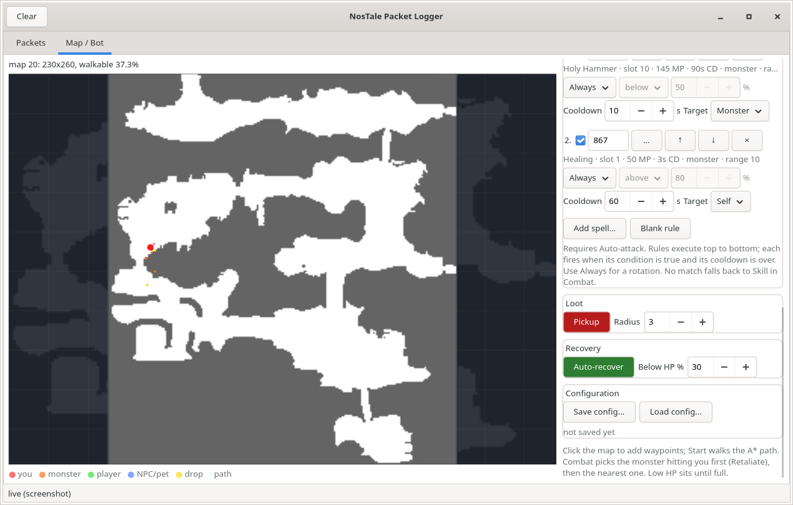

# Bot configuration: targets, spells and export/import

The Map/Bot sidebar contains three configuration sections that are saved
together as JSON: **Targets** (which monsters to fight), **Spells** (conditional
cast rules) and **Configuration** (Save/Load). All of it is optional: with an
empty target list and no spell rules the bot behaves as before (attack every
monster in range, use the Skill from Combat).

## Targets — which monsters to attack

The mode dropdown selects how the target list is interpreted:

| Mode | Behaviour |
|---|---|
| All monsters | attack every monster in range (default) |
| Only selected | attack only monsters whose template vnum is selected (or, with the unknown option, monsters whose vnum is unknown) |
| All except selected | attack every monster except the selected templates |

The list under the dropdown is searchable by monster name or vnum (max 60
matches). Click a checkbox to add/remove a template; selected monsters are
shown first when the search box is empty. **Add vnum** inserts a template that
is missing from the client's name table, **Clear** empties the selection.

The filter uses the monster **template vnum** (`in 3 <vnum> <entityId>`), not
the per-session entity id. This works for monsters that spawned before the GUI
attached because `spawnlog.py` backfills the vnum from the DLL log; see
[map.md](map.md#entities-that-spawned-before-the-host-attached).

**Target focus**: once the bot attacks a monster it keeps that target
until it dies. A closer monster only becomes the target after the current one
is gone (dead, blocked, out of the acquisition radius or without line of
sight). The one exception is **Retaliate**: a monster that hits the
character takes priority over the current target. Once the bot is fighting
such an attacker it stays on it until it dies — a second monster that also
hits the character does not steal the fight, so two attackers cannot make
the bot ping-pong between them. A retaliate switch is named in the Bot log
(`retaliate: <id> is attacking you; switching from <old>`), so it is never
mistaken for a focus failure; when the attacker dies the other recent
attacker (or the original target) is next.

Attacking also requires **line of sight**: the straight line from the
character to the monster must not cross a blocked terrain cell, so the bot
does not fire through town walls or rock ledges (the server refuses those
anyway). If attacks are still refused repeatedly (safe zone, invisible
obstacle), the bot **pauses combat** after a few refusals instead of hopping
to the next target; the pause ends after 30 s or once the character has
moved five cells away. A server `cancel` is paired with the cast it ends, so
the normal end of a landed cast is not counted as a refusal even when the
next attack has already been sent.

**Retaliate ignores the target filter**: a monster that hits the character is
fought even when its vnum is excluded (or unknown), because self-defence must
not depend on a farming whitelist — e.g. an Angry Bee (212) spawned by a
beehive you killed is attacked back in "Only selected" mode. It also works
with **Auto-attack off**: a monster that hits the character is attacked back
(and only that monster), so the bot defends itself while passive targeting is
disabled. Passive targeting still respects the filter in the usual way: in
"only selected" mode an entity whose vnum cannot be resolved is skipped by
default; in "all except selected" it is allowed because it cannot be on the
exclusion list.

**Also attack monsters with unknown vnum** handles the remaining gap: a
monster that was already alive when the DLL was injected has no `in` packet in
the log, so neither the live stream nor the log backfill knows its template.
The bot shows a status warning when such monsters are in range and no allowed
target was found; enable the checkbox to attack them anyway. This is also
saved as `attack_unknown` in the JSON configuration.

The UI makes toggle state explicit: active toggles (Loop, Auto-attack,
Retaliate, Pickup, Auto-recover HP/MP) are **green**, inactive ones are
**red**. While recovery is active and HP or MP is below its threshold, a red
**RECOVERING** banner explains that attacks and movement are paused; the
recovery check runs before targeting and spell rules. Recovery never abandons
a fight: if the bot is already hitting a live target in range, it finishes
that kill first, then sits until the resource that triggered recovery is
full. If a monster hits the character while it is recovering (and is within
attack reach), the bot stands up and fights back instead of sitting in the
line of fire, then resumes recovery once the attacker is gone.

## Spells — scanned catalog, rules and execution order



The **Add spell…** button opens a searchable picker built from the game's own
`NSgtdData.NOS` → `Skill.dat`. Each entry shows the readable name/description
from `_code_<lang>_Skill.txt`, the vnum, MP cost, target mode and cooldown.
**Blank rule** adds an empty row for a manually entered vnum. Each rule also
has a `…` picker button to replace its spell.

The catalog records `Skill.dat` fields: `VNUM`, `NAME` (a `zts<key>e` text
key), `TYPE` (active/passive/system), `TARGET` (target type, hit type, range)
and `DATA` (cast time, cooldown, MP cost). Only `TYPE[0] == 1` records are
offered as active spells. Examples from the live client:

| vnum | name | `u_s` slot (this character) | MP | target | cooldown | cast |
|---|---|---|---|---|---|---|
| 260 | Energy Bolt (mage card) | 0 | 0 | monster | 0.5 s | 0.8 s |
| 866 | Holy Attack (swordsman card) | 0 | 0 | monster | 0.9 s | 0.2 s |
| 867 | Healing | 1 | 50 | monster/any | 3 s | 0.2 s |
| 869 | Mana Shield | 3 | 300 | self | 60 s | 1.0 s |
| 873 | Group Healing | 7 | 250 | self/any | 20 s | 0.4 s |
| 876 | Holy Hammer | 10 | 145 | monster | 90 s | 0.7 s |

**Important:** the first `u_s` field is the **zero-based slot in the
character's learned skill list**, not the Skill.dat vnum. The client sends
`u_s 10 3 <id>` for Holy Hammer and the server answers `su ... 876 ...`; the
live `ski 0 866 866 866 867 ... 876 ...` list gives the slot. The bot stores
the **vnum** in the rule (portable) and resolves it to the slot before
sending, using the live `ski` packet, the DLL-log backfill
(`spawnlog.load_skill_list`), or — when the host attached after login and
never saw `ski` — the slots learned from pairing the client's own
`u_s <slot>` with the answering `su ... <vnum>`
(`spawnlog.load_skill_slots`, and live in `WorldState.skill_learned`). The
rule text shows both the vnum and slot. The picker lists all active spells;
each is marked `slot N`, `not learned` (only when `ski` is known) or `slot
unknown` (no list seen yet — use the spell once in-game or relog with the
logger attached).

Each rule has:

| Field | Meaning |
|---|---|
| order | execution priority, shown as 1., 2., …; up/down arrows change it |
| enabled | rule participates in selection |
| spell | spell vnum sent in `u_s`; the picker fills it from the catalog; 0 is skipped |
| subject | **Always**, **My HP %** or **My MP %** (HP/MP from `stat`) |
| comparator | **below** = strictly lower than the threshold, **above** = strictly higher; disabled for Always |
| threshold | percentage, 0–100 |
| cooldown | minimum seconds before this rule can fire again; the spell's catalog cooldown is also enforced |
| target | **Monster** (nearest/Retaliate target) or **Self** (own char id); self-target spells from Skill.dat override this |

Rules are evaluated **top to bottom** every bot tick. The first enabled rule
that is off cooldown, in spell range, affordable in MP and whose condition is
true wins. With **Always**, the order + cooldowns form a rotation: rule 1
casts, is blocked for its cooldown, rule 2 casts, and so on. Up/down arrows
change priority; the number on the left shows the current order.

Data-driven checks before a cast:

- **basic skill**: Skill `0` is the equipped SP card's basic attack. Its vnum
  is **detected**, not hardcoded: the server answers `u_s 0` with
  `su ... 260 ...` (Energy Bolt on the live mage, 866 on the swordsman), and
  the Combat box shows that record's range, cast time, cooldown and MP. A card
  swap therefore changes the values at the next hit.
- **range**: a basic attack is only sent within the detected skill's
  `TARGET[2]` range (Energy Bolt = 6 cells), even when the **Search** radius
  is larger. Out-of-range attacks are not sent; the status bar reports the
  distance and the bot walks the path instead.
- **MP**: a basic attack with a nonzero `DATA[8]` is not sent when
  `DATA[8] > current MP`; the status bar says so. Spell rules are skipped.
- **range**: a monster spell is skipped when the target is farther than
  `TARGET[2]` (`DATA[11]`) cells.
- **spell cooldown**: the rule's own cooldown is `max(rule.cooldown, catalog
  cooldown)`, so a 90 s spell is not re-cast every few seconds.
- **cast time**: the next action and the walk pause wait at least `DATA[4]`
  The Combat **Min delay** defaults to 0, so it adds nothing on top of the
  Skill.dat values; raise it only to slow the bot down.

Monster rules require a monster in range; the client selects it first
(`TARGET|entityId` → the client's own `ncif 3 <entityId>`) and the skill goes
out on a later tick, once the engine or the DLL confirms the selection:

```
TARGET|entityId
u_s <spell> 3 <entityId>
```

Self rules require the char id and send:

```
u_s <spell> 1 <charId>
```

The monster shape (`u_s <slot> 3 <id>`) and the self-target shape
(`u_s <slot> 1 <charId>`) both match live client captures. Live:
`u_s 10 3 5161` → `su ... 876` (Holy Hammer) and
`u_s 7 1 14881134` → `su 1 14881134 1 14881134 873 ...` (Group Healing).

Only spells whose Skill.dat target type is 1 default to the Self target in the
picker. The old name heuristic was wrong for **Healing 867** (target type 0,
range 10): a self cast is answered with `cancel 0 1 -1`. Use **Group Healing
873** (type 1) for a live-verified self heal; Healing 867 is for another
entity/party target and is not auto-selected as self.

If no rule matches, the bot uses the equipped SP card's basic attack (slot
0). The Combat UI has no Skill/Search/Min delay/template fields; the bot
always uses slot 0, the skill's own range and cooldown, and a 15-cell target
acquisition radius. Recovery runs before spell rules: below **Auto-recover
HP/MP → Below HP/MP %** the bot finishes the current kill, then sits and
waits until the resource that triggered recovery is full, so a heal rule with
a lower threshold does not fire while recovery is active. Spell rules require **Auto-attack** to be
on.

The catalog is loaded in a background thread at startup (Skill.dat decodes
about 1.2 MB); the picker shows a loading row until it is ready. If the file is
missing, the picker is empty and manual vnums still work.

## Death — revive or stop

The server offers an in-place revival dialog after a death
(`dlgi #revival^0 #revival^1 …`, shown as "Continue here? You'll need 10 Seeds
of Power"). The Recovery section has a **Revive on death** toggle:

- **Off (default)**: the bot stops as soon as `stat` reports 0 HP. Nothing is
  spent and no input is sent while dead; revive manually in the game and
  press Start again.
- **On**: the bot waits for `dlgi #revival`, then confirms it with the same
  burst the client's Continue button sends (`mall 50`, `c_close …`,
  `bp_close`, `f_stash_end`) and resumes when the server answers `revive`.
  This spends **10 Seeds of Power** per death; if the revive does not arrive
  within 5 s (not enough seeds, dialog absent) the bot stops.

Saved as `revive_on_death`.

## Block portals — stay on one map

NosTale portals are warp tiles: as soon as the character stands on one, the
client sends its own `preq` (portal request) and the server moves it to the
other map. There is no packet to decline, so **Block portals** (Path section,
on by default) blocks the request itself:

- The DLL drops the client's `preq` before it reaches the socket while the
  toggle is on (the packet still appears in the stream and the log as
  `SEND|preq`, so a blocked attempt is visible). This is the hard guarantee:
  even standing on a warp tile or walking off/onto it cannot change the map.
  The client sends `preq` through its generic packet builder, so both the send
  hook and the skill call-site hook honour the drop.
- A* treats every known warp cell of the current map as an obstacle. The cells
  come from the server's `gp` list, the engine's crossing fallback and the
  persisted portal map (see [map.md](map.md#portals-and-time-space-stones)).
- A map click on a portal is refused while the toggle is on.
- Every `MOVE` is checked against the portal cells, including the straight
  segment from the current position, so a path built before a `gp` arrived
  cannot even head for a tile.
- A drop or monster lying **on** a portal is approached from a neighbouring
  cell (pickup and melee both work from there).

The GUI tells the DLL `PORTALS|1` on every connect and when the toggle
changes, so the protection also covers a character that is already standing on
a portal. Turning the toggle off sends `PORTALS|0` and restores normal
crossing, for example when you actually want to travel to the next map. The
setting is saved as `block_portals`; the live state is in the DLL's status line
(`portalblock=off|BLOCKED`).

## Save and load

**Save config…** writes every setting below to a JSON file; **Load config…**
reads one back. Loading stops a running bot (paths and cooldowns belong to the
old session), validates and clamps every value, and reports errors in the
status bar. The drawn **route** is saved too — waypoints, the Draw path
start point, its map id and the Draw path toggle — so loading the config
redraws the same A* path on the map. Live entity state (monsters, drops,
positions) is not saved.

Example:

```json
{
  "version": 1,
  "auto_attack": true,
  "retaliate": true,
  "skill": 0,
  "skill_template": "u_s {skill} {type} {target}",
  "attack_range": 15,
  "attack_cooldown": 0.0,
  "pickup": true,
  "loot_range": 20,
  "recover": true,
  "low_hp_pct": 70.0,
  "recover_mp": true,
  "low_mp_pct": 70.0,
  "revive_on_death": false,
  "loop": true,
  "block_portals": true,
  "draw_path": false,
  "map_id": 20,
  "waypoints": [[25, 118], [30, 120]],
  "path_start": [24, 117],
  "monster_mode": "only",
  "monster_vnums": [200, 206],
  "attack_unknown": false,
  "spell_rules": [
    {
      "enabled": true,
      "spell": 876,
      "subject": "always",
      "comparator": "below",
      "threshold": 50.0,
      "cooldown": 90.0,
      "target": "monster"
    },
    {
      "enabled": true,
      "spell": 867,
      "subject": "my_hp",
      "comparator": "below",
      "threshold": 50.0,
      "cooldown": 3.0,
      "target": "self"
    },
    {
      "enabled": true,
      "spell": 866,
      "subject": "always",
      "comparator": "below",
      "threshold": 50.0,
      "cooldown": 1.0,
      "target": "monster"
    }
  ]
}
```

The format lives in `linux/host/ntpl/botconfig.py` (`BotConfig`, `SpellRule`,
`save_config`, `load_config`). Unknown fields are ignored; out-of-range numbers
are clamped; a non-object root or invalid JSON raises `ConfigError` instead of
touching the UI.

## Code and tests

- `botconfig.py` — dataclasses, validation, atomic save, load.
- `gui.py` — `_collect_config` / `_apply_config`, the Targets/Spells frames,
  `_monster_allowed`, `_select_spell_rule`, `_cast_spell`.
- `spells.py` — `NSgtdData.NOS` container reader, nibble decode, Skill.dat
  parser and `vnum → SpellInfo` catalog.
- `monsternames.py` — `load_skill_descriptions` provides the readable names.
- `linux/host/tests/test_botconfig.py` — schema round trip, clamping, errors,
  and preservation of spell-rule order/conditions.
- `linux/host/tests/test_spells.py` — parser, self target, known live spells.
- `linux/test/gui_bot_rules_smoke.py` — fake server with two monsters: filter
  selects vnum 200 and ignores the nearer vnum 201; HP 40 % triggers a spell
  rule (867 → slot 1, `u_s 1 3 500`), no basic attack; catalog/picker dialog,
  vnum→slot mapping, MP/range gating and save/load.
- `linux/test/gui_spell_order_smoke.py` — scanned spells 876 (Holy Hammer,
  90 s cooldown) and 866 (Holy Attack): 876 must cast first, then 866 twice
  while 876 is on cooldown; no raw vnums.
- `linux/test/gui_out_of_range_smoke.py` — UI Range 40, monster 35 cells
  away, basic skill range 11: no TARGET/u_s is sent and the status shows the
  out-of-range target.
