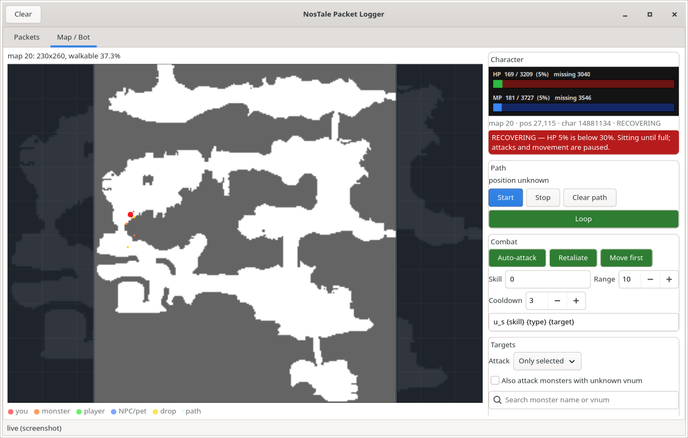

# Maps, walkability, pathing and auto-attack

The map view in the UI is built from the client's own map grids, not from a
hand-drawn guess. This document covers the data format, the parser, the map tab
and the bot loop.


The white cells are walkable ground (`0x00`); the gray area is blocked. This is
map **20** (230x260), the live map from the 2026-11-06 session.

## Data source

`NostaleData/NStcData.NOS` contains one grid per map.

```
header      16 bytes  "NT Data 05" + padding
count       uint32
separator   1 byte
index       count * (map_id:uint32, offset:uint32)
block       at offset:
              creation_date uint32
              data_size     uint32
              compressed    uint32
              is_compressed uint8
              payload       zlib stream when compressed
```

The decompressed payload:

```
width   int16
height  int16
cells   width * height bytes, one per cell, row-major
```

The terrain palette comes from the OnexExplorer/NosTale Research NSTC code:
`0x00` white (open ground), `0x01` gray, `0x02` green, `0x03` black,
`0x09` blue-gray, `0x0A` blue (water), `0x0B` red-brown, `0x0D` yellow-gray,
`0x10` purple, `0x11` green, `0x12` red, `0x13` yellow, `0xFF` purple
(unknown). The engine treats **`0x00` as walkable** and everything else as
blocked for pathfinding; the live data supports this: all 5,849 unique entity
positions observed in the session (173,503 `mv` samples) landed on `0x00`
cells in map 20.

The archive has 779 grids from 9x12 to 488x240. Map **20 (230x260, 37.3 %
walkable)** is the current live map. The map id comes from the server's
`c_map`/`at` packets (`WorldState.map_id`; the id is the second `c_map`
field). If the host attached after login and has not seen one yet, the UI
automatically scores every grid by the live entity positions
(`find_map_for_positions`) and selects the best.

## Parser API

`linux/host/ntpl/mapdata.py` (standard library only):

| Function | Meaning |
|---|---|
| `load_nstc(path)` | parse the archive into `{map_id: MapGrid}` |
| `MapGrid.at(x, y)` | terrain byte or `None` |
| `MapGrid.is_walkable(x, y)` | `at() == 0x00` |
| `MapGrid.neighbours(x, y)` | walkable 8-direction neighbours; diagonals require both orthogonal cells to be walkable |
| `astar(grid, start, goal)` | shortest 8-direction path (diagonal cost sqrt 2), goal included |
| `find_map_for_positions(grids, points)` | rank maps for live coordinates |
| `terrain_rgb(value)` | palette colour |

Override the archive path with `NTPL_NSTC` or `--file`.

## Monster names

`NSlangData_<lang>.NOS` in the same `NostaleData` directory holds the client's
text tables. The monster table is `_code_uk_monster.txt` (the language suffix
follows the installed client) and contains one record per template:

```
zts200e	Mountain Turtle
zts206e	Angry Queen Bee
zts223e	Small Wiggler
zts5160e	Crazed Crusader
```

The archive layout:

```
count       uint32
entry       count times:
              number       uint32
              name_size    uint32
              name         name_size bytes
              is_dat       uint32
              data_size    uint32
              data         data_size bytes, encoded
```

`.txt`/`.dat` entries use the client's nibble codec: a control byte carries a
count; when bit 7 is set the low/high half-bytes index a 16-character alphabet,
otherwise the following bytes are XOR `0x33`; `0xFF` emits a carriage return.
`monsternames.py` implements the archive reader and the codec, then parses the
`zts<vnum>e\t<name>` records into `{vnum: name}` (2,795 entries in the current
UK client). `NTPL_NSLANG` selects an explicit archive; otherwise the file is
looked up next to `NStcData.NOS` (`NTPL_NSTC`), preferring `UK`, then any other
language. A missing archive yields an empty table and the UI falls back to the
entity id.

Important: the `in 3 <vnum> <entityId> <x> <y> ...` spawn packet carries the
template vnum first and the per-session entity id second. The map's `ncif`,
`u_s` and `su` packets use the **entity id**; tooltips resolve it to the name
through the stored vnum. For example, live `in 3 206 5122 ...` is entity 5122,
an Angry Queen Bee (vnum 206).

### Entities that spawned before the host attached

The host only receives packets after it connects. A monster that was already
alive is first seen as `mv`/`tp`, which carries no vnum, so its tooltip used to
fall back to the entity id. The DLL's packet log covers the whole client
session (it is truncated when the DLL is injected), so `spawnlog.py` scans its
`[RECV] in ...` lines at GUI startup and fills `entity id → vnum` plus player
names. Later log entries override earlier ones, which handles a reused entity
id.

`spawnlog.py` looks for `C:\NosTalePacketLog.txt` inside `$WINEPREFIX`, then
the dedicated prefix and the Gameforge prefix on this machine. Override it
with `NTPL_LOG=<path>` or `ntpl gui --log <path>`. Missing logs are harmless:
the GUI simply keeps the activity from the live packet stream.

## CLI

```bash
# size, walkable percentage and a cell
linux/scripts/host.sh map info 20 --at 25,117

# render the whole map to PNG (PIL) or PPM (fallback)
linux/scripts/host.sh map render 20 /tmp/map20.png --scale 3

# rank maps against a live packet log (mv positions)
linux/scripts/host.sh map best --log "$WINEPREFIX/drive_c/NosTalePacketLog.txt"
```

## UI map tab

`linux/scripts/gui.sh` opens the window. The **Map / Bot** tab is split into a
map on the left and a scrollable control sidebar on the right. The layout is
grouped by function:

- **Map bar** — only the live map info (id, size, walkable %). There is no Map
  ID/Load/Auto-detect/Scale/Center control: the map is selected automatically
  and uses a "contain" fit: the **whole map** is scaled to the largest size
  that fits the widget, with its aspect ratio fixed. The letterbox area is a
  dimmed copy of the same map, so it reads as part of the map instead of black
  bars. On a portal crossing the server sends `c_map 0 <oldMap> 0` →
  `mapout` → `at <charId> <newMap> …` → `c_map 0 <newMap> 1`; the GUI switches
  on the `c_map`/`at` pair as soon as the packet arrives (the 2 s auto-map
  tick remains only as a fallback). Note that the map id is the **second**
  `c_map` field — the first is a type.
- **Character** — live HP and MP bars with current/max/missing values, plus
  map/position/char id. HP and MP are fed by the server's `stat` packets.
  While recovering, a red **RECOVERING** banner states the HP percentage and
  that attacks/movement are paused; all toggle buttons are green when active
  and red when off.
- **Path** — path summary, Start, Stop, Clear path, Loop.
- **Combat** — Auto-attack, Retaliate, Skill, Range, Cooldown and the skill
  template.
- **Targets** — monster filter: all monsters, only the selected templates, or
  all except the selected ones. Search the client's monster table by name or
  vnum, or add a vnum manually. **Also attack monsters with unknown vnum**
  covers monsters that spawned before the DLL was injected and therefore
  have no `in` packet.
- **Spells** — **Add spell…** opens a searchable catalog scanned from
  `NSgtdData.NOS` → `Skill.dat` (name, vnum, MP, target, cooldown). Rules are
  ordered 1., 2., … and can use **Always**, My HP % or My MP %; the first rule
  that is off cooldown, in range and affordable wins. Always + cooldowns forms
  a rotation. Otherwise the **Skill** in Combat is the fallback.
- **Loot** — Pickup and loot radius.
- **Recovery** — Auto-recover and the low-HP threshold.
- **Configuration** — Save/Load the whole bot configuration as JSON.

See [bot-config.md](bot-config.md) for the target filter, spell-rule semantics
and the export/import schema.

The layout is responsive: wide windows show map + sidebar side by side; below
~1050 px the map moves above the controls. The map redraws are coalesced at
~80 ms instead of one redraw per packet. Right-click removes the last waypoint;
left-click adds one. The packet **Follow** toggle lives in the Packets tab, not
in the window header.

| Control | Effect |
|---|---|
| Move first | attack while walking; turn off to clear nearby monsters before moving on (default on) |
| Retaliate | attack the monster that most recently hit you first, if in range |
| Auto-recover | below the HP threshold, sit and wait for full HP, then stand |
| Below HP % | recovery threshold (default 30) |
| Pickup / Loot | pick up your own/unowned drops within the radius |
| Skill | skill vnum (default **0** = normal/basic attack; the client sends `u_s 0 3 <monster>` and the server reports the basic skill, e.g. 866, in `su`) |
| Range / Cooldown | attack radius and seconds between attacks |
| Loop | repeat the path when it finishes |
| Targets | all / only selected / all except selected monster templates (`vnum`); Retaliate respects the same filter |
| Spell rule | scanned spell + Always/My HP/My MP + below/above + cooldown + Monster/Self target; ordered top to bottom; static MP/range/cooldown checks from Skill.dat |
| Save/Load config | export/import the toggles, numbers, target list and spell rules as JSON |

The A* path is drawn as one continuous cyan polyline through cell centres.
Diagonal steps make it read as a direct line instead of a staircase, and
corner cutting is rejected so the line never crosses a blocked corner.

Hovering a map marker shows a tooltip: **You** with char id, position and map;
a **Player** with name, char id, position and distance; a **Monster/NPC** with
name, entity id, template vnum, position and distance (plus “attacking you” for
the last attacker); and a **drop** with item vnum, amount, drop id, owner and
distance. Monster names come from the client's own language data (see below);
when a vnum is not in that table the tooltip falls back to the entity id.

Overlays: cyan path, yellow waypoints, **gold diamonds for drops**, green
players, blue NPCs/pets, orange monsters. The own character is a **bigger red
dot with a white ring and a red facing arrow**. The arrow follows the last
`walk` delta (map coordinates: `+x` right, `+y` down), so it has eight
directions. The protocol has no own-facing packet: `in` carries a direction
only at spawn, and every observed character kept one constant spawn direction
regardless of movement. Deriving the arrow from movement is therefore the
honest source.



## Bot loop

`_bot_tick` runs on the GTK main loop every 200 ms:

1. **Recovery** — if Auto-recover is on and HP is below the threshold, stop
   the current walk, sit (`rest 1 1 <charId>` unless already sitting) and wait.
   No attack, pickup or movement happens until HP is full; then the bot stands
   (`rest`) and resumes the path. `stat` is the source of HP/MP.
2. **Stand up** if `WorldState.resting` is true and the char id is known:
   `rest 1 1 <charId>` (the server toggles sit/stand; sitting blocks movement).
3. **Pick up** if enabled and a drop owned by you (or unowned) is within the
   loot radius: send `get 1 <charId> <dropId>`. Each drop is tried at most
   three times; the server's `get` confirmation removes it from
   `WorldState.drops`.
4. **Move first / Auto-attack.** Auto-attack is not disabled by the path: with
   **Move first** on (the default) the bot attacks whenever the cooldown is
   ready and then resumes the path after the attack animation, so monsters
   along the route are fought without waiting for the area to be clear. With
   Move first **off** it holds the current position and keeps attacking until
   no monster is within range, then moves on ("clear the area"). With no path,
   Start still runs stationary combat, pickup and recovery.
   Target choice: with **Retaliate** on, first try the most recent `su`
   attacker that hit you (within 5 s); otherwise pick the nearest `kind == 3`
   entity within range. Both paths apply the **Targets** filter.
   Spell rules are evaluated before the basic attack in list order: the first
   enabled rule that is off its per-rule cooldown, has enough MP, has the
   target in spell range and whose condition (Always or HP/MP threshold) is
   true is cast on the monster or on yourself. **Always** plus cooldowns is a
   rotation. If none matches, the **Skill** from Combat is used (`0` = basic
   attack). Monster casts send `ncif 3 <id>` plus the skill template; self
   casts use target type 1 and the char id. The rule stores the Skill.dat
   vnum; the bot resolves it to the zero-based `u_s` slot from the learned
   `ski` list (e.g. 876 → slot 10) before sending. Cast time from Skill.dat
   extends the walk pause.
5. **Walk** a multi-cell leg (three cells from the A* path, plus the final
   cell on the 8-direction path) by calling the client's own MoveTo: the GUI
   sends `MOVE|x y` to the DLL. The client pathfinds,
   animates and sends its own `walk` packet with
   the leg destination; the server accepts it as a normal player move. Because
   that packet arrives at the **start** of the animation, the bot waits
   `0.45 s` per Euclidean cell of travel (minimum 0.35 s) before sending the
   next leg, so diagonal legs are paced correctly and the character walks
   continuously instead of stopping after every single cell.
   On a timeout it skips the leg (blocked path) and stops after three
   consecutive rejections.
6. Repeat/loop; Stop ends the timer.

The bot sends ordinary packets (`ncif`, `u_s`, `rest`) through the existing
`PacketClient` and uses the DLL's `MOVE`/`POS` commands for movement. It never
touches GTK from a worker thread. The engine feeds it the live `tp`, `mv`,
`rest`, `cond`, `su` and `stat` packets. On connect the GUI sends `POS` to
learn the client's local position, because a host that attaches after login
never sees the `at` packet.

### Limits

- A `0x00` cell can still contain an object or entity at the pixel level; if
  the client refuses the path or the server rejects the move, the bot skips the
  leg after the timeout.
- Leg size and pacing are constants in `gui.py` (three cells; `walk_confirm_
  delay = 0.45 s/cell`). A very long `MOVE` makes the client jump to the
  destination rather than animate, so keep legs short.
- `MOVE` calls a client-build-specific function (`0x565E88`). The DLL validates
  its prologue and reports `MOVE: client build mismatch` after a client patch
  instead of crashing. `POS` reads the client's local player object
  (`[[0x792468]]`): int16 x at +4, y at +6, char id at +0x24.
- Packet-only walking is still possible (`SEND|walk` with
  `walk_checksum(x, y)`), and the checksum is `1 if (x + y) % 3 == 1`; but the
  client does not animate such a walk, and the server's correction teleports
  the character. `MOVE` is the visible path.
- The facing arrow reflects the last **walk target**, not an independently
  turning character. The live protocol exposes no own-facing field; `in` spawn
  directions are constant per character. If the game turns in place, the arrow
  does not change until the next move.
- Pickup only considers drops owned by your char id or unowned (`owner_id` 0);
  another player's drops are skipped. The default loot radius is 3 cells; the
  bot does not walk to distant drops by itself yet.
- The verified `u_s` prefix is `<skill> <targetType> <targetId>`; later
  fields are unknown. `u_s 0 3 <id>` is the normal attack and skill 10 cast
  produced `su ... 876` live. Self-target rules use `u_s <slot> 1 <charId>`;
  live `u_s 7 1 14881134` → `su ... 873` (Group Healing). The template is
  editable.
- Auto-attack targets `kind == 3` only, within **Range**. Skill **0** is the
  normal attack; the server reports the basic skill (866/868) in `su`. Skill
  866 itself is not castable and gets `cancel 0 866 -1`.
- The Targets filter compares the monster **template vnum** (from `in`, with
  the DLL-log backfill). In "only selected" mode an entity whose vnum cannot
  be resolved is skipped; in "all except selected" it is allowed because it
  cannot be on the exclusion list.
- Spell rules require **Auto-attack** to be on. The recovery check runs first:
  below the Auto-recover threshold the bot sits, so a heal rule with a lower
  threshold never fires while recovery is active. Self-target rules use the
  current char id and send `u_s <spell> 1 <charId>`.
- The spell catalog comes from `NSgtdData.NOS` → `Skill.dat`; names/descriptions
  come from `_code_<lang>_Skill.txt` through the record's `NAME` key. The
  `u_s` field is a zero-based slot in the learned skill list from `ski`, not
  the Skill.dat vnum: live `u_s 10` → `su ... 876`, `u_s 7` → `su ... 873`.
  The bot resolves vnums to slots using the live list or the DLL-log backfill. MP cost,
  range, cast time and cooldown are static game data and are enforced before a
  rule is selected; the rule's own cooldown can only make it stricter. A
  spell whose target type is self overrides the rule's Monster/Self choice.
- Skill.dat also contains monster/system records. The picker filters to active
  skills (`TYPE[0] == 1`) and hides empty/NotUse names; a manual vnum can still
  reference any id.
- The map id comes from `c_map`/`at`. If the host attached after login and has
  not seen either yet, the GUI ranks the map grids against live player
  positions every 2 s and keeps the current map while it still fits.
- The server may rate-limit or reject moves after many attempts; the bot stops
  after three consecutive unconfirmed moves.

## Tests

```bash
make -C linux host-test   # 83 cases incl. synthetic NOS, 8-way A*, checksum, config
make -C linux gui-test    # GUI + map surface + tooltips + unknown-position guard
make -C linux bot-test    # 5 fake-server smokes: combat, rules, rejection, recovery
```

The bot test sends a fake player at (25,117) on map 20, a monster at
(25,118) and a drop at the player's feet; it asserts the engine sent
`get 1 14881134 999`, `ncif 3 500`, `u_s 0 3 500` and `MOVE|26 119` (not an
injected walk), and the fake client answered with its own `walk`. A second
test makes the server silent and asserts the bot stops after three rejected
moves. The third test sits the bot at full HP to verify the sit/stand recovery
loop. The rules smoke presents two monsters (vnum 201 nearer, vnum 200
farther), allows only vnum 200, sets HP to 40 % and a spell rule (spell 7, my
HP below 50 %), then asserts `ncif 3 500` + `u_s 7 3 500`, no traffic to 501,
no basic attack, and that save/load restores the config. See
[bot-config.md](bot-config.md).

## Live status

- Map **20** is current; 100 % of 173,503 `mv` samples are on walkable cells.
- Client-side walking was verified live on 2026-11-06. The GUI bot walked a
  six-cell A* path `(21,141)→(18,138)` via the checksum/probe method, then a
  second six-cell path `(26,133)→(23,130)` through the client's own MoveTo:
  the log contains only client `[SEND] walk` lines, no injected walks, no
  probes and no server `tp` teleports. The character animates normally.
- Live auto-attack is verified: the bot walked from `(45,184)` toward nearby
  monsters and landed multiple `su 1 14881134 3 <id> 866 ...` hits with
  `u_s 0 3 <id>` (2026-11-06 ~15:54). Movement and combat are both working.
- Live pickup is verified: a drop `drop 5193 13979116 49 169 1 0 14881134`
  produced `MANUAL_SEND get 1 14881134 13979116` and the server confirmed with
  `RECV get 1 14881134 13979116 0` (2026-11-06 ~15:57).
- Map switching is live-verified from the portal capture 20 ↔ 85:
  `c_map 0 20 0` → `mapout` → `at ... 85 ...` → `c_map 0 85 1`, and back.
  The GUI follows the second `c_map` field immediately.
- Monster names are mapped live: e.g. entity 5032/vnum 200 (Mountain Turtle),
  5068/201 (Rock Turtle), 5122/206 (Angry Queen Bee), 5161/223 (Small
  Wiggler). Tooltips show the name, entity id and vnum.
- Pathing is now 8-direction A* with diagonal steps and a continuous polyline.
  The headless tests cover the diagonal shortcut and corner-cut rejection;
  the client's MoveTo still performs the actual movement, so watch the first
  live diagonal run.
- Target filters, spell rules, JSON config and the recovery banner/toggle
  colours are covered by the headless GUI/rules smokes. The live client
  confirmed the reason “only selected” can look idle: recovery was sitting at
  24 % HP, and pre-injection wasps had no vnum in the log (the unknown-vnum
  option now covers them).
